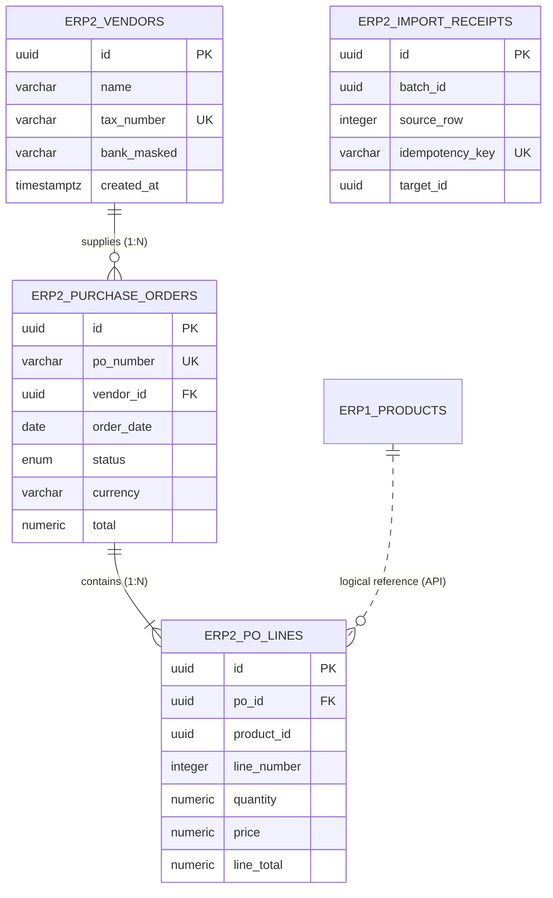

# ERP-2 Vendors & Purchasing — Data Dictionary

**SDS Reference**: ClearShift ERP v2.0, §4.3 (FR-ERP2-01..06, BR-ERP2-01), §4.7 (ERP-2 tables)
**Architecture Reference**: ClearShift V1 Master Architecture Spec §5 (ERD), §6.1 (slot 01), Decision C7 (intra-module FKs only)
**Module**: ERP-2 Vendors & Purchasing (Group 7)
**Issue**: [#16](https://github.com/SamAltmanBT29/Clearshift-ERP/issues/16) — `[ERP2-01] ERP-2 Vendors and Purchasing schema, Drizzle models, and guarded migrations`
**PostgreSQL Schema**: `erp2`
**API Base**: `/api/v1/erp-vendors`
**Version**: V1.0

---

## Table of Contents

1. [Ownership & Boundaries](#1-ownership--boundaries)
2. [`erp2.vendors`](#2-erp2vendors--vendor-master)
3. [`erp2.purchase_orders`](#3-erp2purchase_orders--purchase-order-header)
4. [`erp2.po_lines`](#4-erp2po_lines--purchase-order-lines)
5. [`erp2.import_receipts`](#5-erp2import_receipts--idempotency--migration-audit)
6. [Constraints Reference](#6-constraints-reference)
7. [Entity Relationship Diagram](#7-entity-relationship-diagram)
8. [Domain Rules & Invariants](#8-domain-rules--invariants)
9. [API Baseline](#9-api-baseline)
10. [Decision Records](#10-decision-records)

---

## 1. Ownership & Boundaries

| Object | Owner | Notes |
|---|---|---|
| `erp2.vendors` | ERP-2 | Supplier and vendor master data |
| `erp2.purchase_orders` | ERP-2 | Purchase order headers and lifecycle state |
| `erp2.po_lines` | ERP-2 | Purchase order line items, quantities, prices and totals |
| `erp2.import_receipts` | ERP-2 | Durable import receipts (KIT-08 / Master Arch Spec §6.1 slot 01) |
| `erp1.products` | ERP-1 | Referenced logically by `product_id`; NO cross-module DB foreign key |
| `public.schema_migrations` | Platform | Shared migration ledger written by the controlled migration runner |

**Cross-module boundary (Decision C7).** All foreign keys in `erp2` point exclusively at another `erp2` table (`purchase_orders.vendor_id` -> `vendors.id`, `po_lines.po_id` -> `purchase_orders.id`). Line items reference product IDs in ERP-1 logically; validation is enforced via the ERP-1 public API contract or approved projection, not through a cross-schema database foreign key. No sibling module and no Migration Kit adapter may write into the `erp2` schema directly.

---

## 2. `erp2.vendors` — Vendor Master

**Purpose**: Stores supplier and vendor records.
**FR Reference**: FR-ERP2-01 (list/search by name), FR-ERP2-02 (create/edit vendor), FR-ERP2-06 (bank detail masking)
**Owner**: ERP-2

| Column | PostgreSQL Type | Nullable | Default | Meaning | Constraints |
|---|---|---|---|---|---|
| `id` | `UUID` | NOT NULL | `gen_random_uuid()` | Primary key | PK |
| `name` | `VARCHAR(255)` | NOT NULL | — | Legal or trading vendor name | CHECK `vendors_name_not_empty` |
| `tax_number` | `VARCHAR(64)` | NOT NULL | — | Tax identification number (e.g. GSTIN, VAT) | UNIQUE `vendors_tax_number_unique`, CHECK `vendors_tax_number_not_empty` |
| `email` | `VARCHAR(255)` | NULL | — | Contact email address | — |
| `phone` | `VARCHAR(64)` | NULL | — | Contact phone number | — |
| `address_line` | `VARCHAR(255)` | NULL | — | Street address line | — |
| `city` | `VARCHAR(120)` | NULL | — | City name | — |
| `country` | `VARCHAR(64)` | NULL | — | Country name or ISO code | — |
| `bank_details_raw` | `TEXT` | NULL | — | Internal raw bank account details (never serialized) | — |
| `bank_masked` | `VARCHAR(32)` | NULL | — | Masked bank account display (`XXXX-XXXX-7890`) | CHECK `vendors_bank_masked_format` |
| `source_system` | `VARCHAR(64)` | NULL | — | Migration Kit provenance: source system name | — |
| `source_id` | `VARCHAR(128)` | NULL | — | Migration Kit provenance: source identifier | — |
| `created_at` | `TIMESTAMPTZ` | NOT NULL | `now()` | Row creation timestamp (UTC) | — |
| `updated_at` | `TIMESTAMPTZ` | NOT NULL | `now()` | Last update timestamp (UTC); trigger-maintained | — |

**Indexes**:
- `vendors_tax_number_unique` — UNIQUE on `(tax_number)`
- `vendors_name_idx` — B-tree on `(name)`
- `vendors_source_idx` — B-tree on `(source_system, source_id)`

---

## 3. `erp2.purchase_orders` — Purchase Order Header

**Purpose**: Stores purchase order headers and tracking status.
**FR Reference**: FR-ERP2-03 (PO with lines), FR-ERP2-04 (status lifecycle), FR-ERP2-05 (total calculation)
**Owner**: ERP-2

| Column | PostgreSQL Type | Nullable | Default | Meaning | Constraints |
|---|---|---|---|---|---|
| `id` | `UUID` | NOT NULL | `gen_random_uuid()` | Primary key | PK |
| `po_number` | `VARCHAR(64)` | NOT NULL | — | Unique PO reference number (e.g. `PO-2026-0001`) | UNIQUE `purchase_orders_po_number_unique`, CHECK `purchase_orders_po_number_not_empty` |
| `vendor_id` | `UUID` | NOT NULL | — | Vendor reference (intra-module) | FK → `erp2.vendors(id)` ON DELETE RESTRICT |
| `order_date` | `DATE` | NOT NULL | `CURRENT_DATE` | Date the order was placed | — |
| `status` | `erp2.purchase_order_status` | NOT NULL | `'draft'` | Lifecycle state: `draft`, `sent`, `received`, `closed` | Enum check |
| `currency` | `VARCHAR(3)` | NOT NULL | `'INR'` | ISO 4217 3-letter currency code | CHECK `purchase_orders_currency_format` |
| `total` | `NUMERIC(18,2)` | NOT NULL | `0.00` | Order total calculated from line items | CHECK `purchase_orders_total_non_negative` |
| `notes` | `TEXT` | NULL | — | Operational notes or terms | — |
| `source_system` | `VARCHAR(64)` | NULL | — | Migration Kit provenance: source system name | — |
| `source_id` | `VARCHAR(128)` | NULL | — | Migration Kit provenance: source identifier | — |
| `created_at` | `TIMESTAMPTZ` | NOT NULL | `now()` | Row creation timestamp (UTC) | — |
| `updated_at` | `TIMESTAMPTZ` | NOT NULL | `now()` | Last update timestamp (UTC); trigger-maintained | — |

**Indexes**:
- `purchase_orders_po_number_unique` — UNIQUE on `(po_number)`
- `purchase_orders_vendor_id_idx` — B-tree on `(vendor_id)`
- `purchase_orders_status_idx` — B-tree on `(status)`
- `purchase_orders_order_date_idx` — B-tree on `(order_date)`

---

## 4. `erp2.po_lines` — Purchase Order Lines

**Purpose**: Stores line items belonging to a purchase order.
**FR Reference**: FR-ERP2-03 (lines with product, quantity, price), BR-ERP2-01 (product validation), FR-ERP2-05 (server calculation)
**Owner**: ERP-2

| Column | PostgreSQL Type | Nullable | Default | Meaning | Constraints |
|---|---|---|---|---|---|
| `id` | `UUID` | NOT NULL | `gen_random_uuid()` | Primary key | PK |
| `po_id` | `UUID` | NOT NULL | — | Parent purchase order | FK → `erp2.purchase_orders(id)` ON DELETE CASCADE |
| `product_id` | `UUID` | NOT NULL | — | Logical reference to ERP-1 product | BR-ERP2-01 (API validation; no cross-schema DB FK) |
| `line_number` | `INTEGER` | NOT NULL | — | 1-based sequential line index | UNIQUE `(po_id, line_number)` |
| `quantity` | `NUMERIC(18,4)` | NOT NULL | — | Ordered quantity (strictly positive) | CHECK `po_lines_quantity_positive` (`quantity > 0`) |
| `price` | `NUMERIC(18,2)` | NOT NULL | — | Unit price in order currency | CHECK `po_lines_price_non_negative` (`price >= 0`) |
| `line_total` | `NUMERIC(18,2)` | NOT NULL | — | Calculated line amount: `quantity * price` | CHECK `po_lines_line_total_non_negative` (`line_total >= 0`) |
| `created_at` | `TIMESTAMPTZ` | NOT NULL | `now()` | Row creation timestamp (UTC) | — |
| `updated_at` | `TIMESTAMPTZ` | NOT NULL | `now()` | Last update timestamp (UTC); trigger-maintained | — |

**Indexes**:
- `po_lines_po_line_number_unique` — UNIQUE on `(po_id, line_number)`
- `po_lines_po_id_idx` — B-tree on `(po_id)`
- `po_lines_product_id_idx` — B-tree on `(product_id)`

---

## 5. `erp2.import_receipts` — Idempotency & Migration Audit

**Purpose**: Durable import receipts persisted in the same transaction as target business mutations.
**KIT Reference**: KIT-08 / Master Architecture Spec §6.1 slot 01
**Owner**: ERP-2

| Column | PostgreSQL Type | Nullable | Default | Meaning | Constraints |
|---|---|---|---|---|---|
| `id` | `UUID` | NOT NULL | `gen_random_uuid()` | Primary key | PK |
| `batch_id` | `UUID` | NOT NULL | — | Migration Kit batch identifier | — |
| `source_row` | `INTEGER` | NOT NULL | — | Row number in source batch | — |
| `entity` | `VARCHAR(64)` | NOT NULL | — | Target entity name (`vendor`, `purchase_order`) | — |
| `schema_version` | `INTEGER` | NOT NULL | `1` | Schema version at import time | — |
| `idempotency_key` | `VARCHAR(128)` | NOT NULL | — | Stable idempotency key: `batch_id + source_row + entity` | UNIQUE `import_receipts_idempotency_key_unique` |
| `target_id` | `UUID` | NOT NULL | — | Target primary key written | — |
| `kind` | `VARCHAR(16)` | NOT NULL | `'created'` | Operation kind (`created`, `updated`) | — |
| `created_at` | `TIMESTAMPTZ` | NOT NULL | `now()` | Receipt commit timestamp (UTC) | — |

**Indexes**:
- `import_receipts_idempotency_key_unique` — UNIQUE on `(idempotency_key)`
- `import_receipts_batch_row_idx` — B-tree on `(batch_id, source_row)`

---

## 6. Constraints Reference

### Check Constraints
| Name | Table | Condition | Purpose |
|---|---|---|---|
| `vendors_name_not_empty` | `erp2.vendors` | `length(trim(name)) > 0` | Forbids whitespace-only or empty names |
| `vendors_tax_number_not_empty` | `erp2.vendors` | `length(trim(tax_number)) > 0` | Forbids empty tax numbers |
| `vendors_bank_masked_format` | `erp2.vendors` | `bank_masked IS NULL OR bank_masked ~ '^XXXX-XXXX-[0-9]{4}$'` | Enforces server-side bank mask pattern |
| `purchase_orders_po_number_not_empty` | `erp2.purchase_orders` | `length(trim(po_number)) > 0` | Forbids empty PO number |
| `purchase_orders_currency_format` | `erp2.purchase_orders` | `currency ~ '^[A-Z]{3}$'` | Requires standard ISO 4217 3-letter currency |
| `purchase_orders_total_non_negative` | `erp2.purchase_orders` | `total >= 0` | Eliminates negative order totals |
| `po_lines_quantity_positive` | `erp2.po_lines` | `quantity > 0` | Lines must have strictly positive quantities |
| `po_lines_price_non_negative` | `erp2.po_lines` | `price >= 0` | Unit price cannot be negative |
| `po_lines_line_total_non_negative` | `erp2.po_lines` | `line_total >= 0` | Computed line total cannot be negative |

### Foreign Keys (Decision C7: Intra-module only)
| Table | Column | References | On Delete |
|---|---|---|---|
| `erp2.purchase_orders` | `vendor_id` | `erp2.vendors(id)` | `RESTRICT` |
| `erp2.po_lines` | `po_id` | `erp2.purchase_orders(id)` | `CASCADE` |

---

## 7. Entity Relationship Diagram

---

## 8. Domain Rules & Invariants

1. **Product Reference (BR-ERP2-01):** Every purchase order line must reference an existing product through the owning ERP-1 API contract. Unknown product = rejected row. No database foreign key crosses schema boundaries.
2. **Order Total Recomputation (FR-ERP2-05):** Order total is recomputed server-side from lines using fixed-precision decimal arithmetic. Client-submitted totals are non-authoritative.
3. **Purchase Order Status Flow (FR-ERP2-04):** Allowed lifecycle is forward-only: `draft` -> `sent` -> `received` -> `closed`. Backwards transitions or cancellations are rejected in V1.
4. **Bank Details Masking (FR-ERP2-06):** Bank details are never returned unmasked. Mask format is `XXXX-XXXX-7890`. Raw bank account numbers are never returned in public API payloads or log output.
5. **Currency Consistency:** All financial amounts are non-negative `NUMERIC(18,2)` with an explicit ISO 4217 code. No FX conversions occur in V1.

---

## 9. API Baseline

| Method | Endpoint | Description |
|---|---|---|
| `GET` | `/api/v1/erp-vendors/vendors` | Search and list vendors with bounded paging |
| `POST` | `/api/v1/erp-vendors/vendors` | Create new vendor |
| `PATCH` | `/api/v1/erp-vendors/vendors/{id}` | Update vendor details |
| `GET` | `/api/v1/erp-vendors/purchase-orders` | List purchase orders with status/vendor filters |
| `GET` | `/api/v1/erp-vendors/purchase-orders/{id}` | Retrieve purchase order with line items |
| `POST` | `/api/v1/erp-vendors/purchase-orders` | Create purchase order with validated lines |
| `PATCH` | `/api/v1/erp-vendors/purchase-orders/{id}` | Advance purchase order status |

---

## 10. Decision Records

| Decision | Context | Rationale | Resolution |
|---|---|---|---|
| **DR-ERP2-01: Intra-module FKs only (Decision C7)** | SDS lists `product_id` in `erp2_po_lines`. Sibling module `erp1` owns `erp1_products`. | Cross-schema foreign keys create hard deployment coupling and violate module boundaries. | `product_id` is a UUID column validated logically via ERP-1 contract; no DB FK. |
| **DR-ERP2-02: Server-side bank masking (FR-ERP2-06)** | Client may submit raw bank details. | Security requires bank numbers to never be stored or displayed in plain text to viewers. | Stored as `bank_masked` formatted as `XXXX-XXXX-7890`; raw details withheld from API serialization. |
| **DR-ERP2-03: Server-side total calculation (FR-ERP2-05)** | Clients might submit inaccurate totals. | Prevents accounting discrepancies between lines and header. | Server recalculates `line_total = quantity * price` and `total = sum(line_totals)`. |
