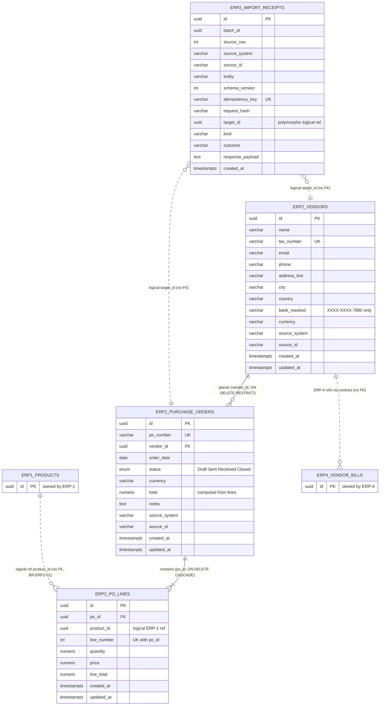

# ERP-2 Vendors & Purchasing: Entity-Relationship Diagram

**Issue**: [ERP2-24 / #140](https://github.com/SamAltmanBT29/Clearshift-ERP/issues/140), Gate G1 design artifact
**Schema**: `erp2`. Column detail lives in [`field-level-data-dictionary.md`](./field-level-data-dictionary.md).

## 1. Diagram

Solid lines are real database foreign keys (all inside `erp2`). Dotted lines are **logical references with no database FK** (Decision C7).

`ERP1_PRODUCTS` and `ERP4_VENDOR_BILLS` are drawn only to show the boundary. Their columns are not owned or modified here.

## 2. Keys

| Table | Primary key | Unique keys | Foreign keys |
|---|---|---|---|
| `erp2.vendors` | `id` | `tax_number` | none |
| `erp2.purchase_orders` | `id` | `po_number` | `vendor_id -> erp2.vendors.id` (RESTRICT) |
| `erp2.po_lines` | `id` | `(po_id, line_number)` | `po_id -> erp2.purchase_orders.id` (CASCADE) |
| `erp2.import_receipts` | `id` | `idempotency_key` | none |

## 3. Master-data ownership boundaries

| Entity | Master owner | Who may write | Who may read |
|---|---|---|---|
| Vendor (`erp2.vendors`) | **ERP-2** (vendor master is owned here) | ERP-2 API and the ERP-2 Migration Kit target adapter only | Other modules through the ERP-2 public contract |
| Purchase order and lines | **ERP-2** | ERP-2 API and adapter only | ERP-4 through contract / outbox events |
| Import receipts | **ERP-2** | ERP-2 adapter, inside the same transaction as the target write | ERP-2 import screens |
| Product (`erp1.products`) | **ERP-1** | ERP-1 only | ERP-2 verifies existence through the ERP-1 public API or approved projection (`ReferenceResolver`) |
| Vendor bills / accounting refs | **ERP-4** | ERP-4 only | n/a |
| `public.schema_migrations` | Platform | Shared migration runner only | n/a |

## 4. Boundary rules

1. Every database FK in `erp2` targets another `erp2` table. There is no FK into `erp1` or `erp4`.
2. A line whose `product_id` is unknown to ERP-1 is rejected (BR-ERP2-01). In bulk imports it becomes a rejected row, not a partial order.
3. ERP-2 does not alter any schema owned by another module. Changes need an approved API contract first.
4. Cardinalities: one vendor has zero or many orders; one order has one or many lines (an order with zero lines is rejected); one product can appear on many lines.
5. Deletes: a vendor with orders cannot be deleted (RESTRICT); deleting an order deletes its lines (CASCADE). V1 exposes no DELETE or PUT endpoint at all (OpenAPI parity test).
6. `import_receipts.target_id` is intentionally polymorphic (vendor or purchase order), so it cannot be a DB FK.

## 5. Known model differences

The SQL migration and the Drizzle model differ in several places (status enum name and casing, `vendors.email` nullability, lengths, defaults). The full list is the Drift register in [`field-level-data-dictionary.md`](./field-level-data-dictionary.md#6-drift-register-sql-migration-vs-drizzle-model). This diagram follows the SQL migration for structure.
