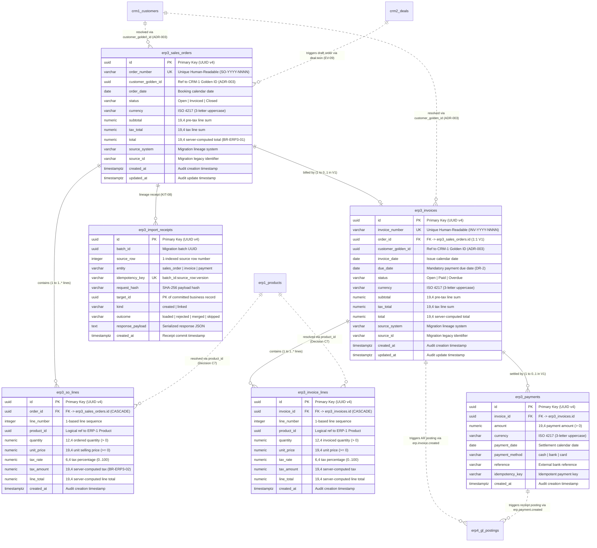

# ERP-3 Sales Orders & Invoices — Canonical Data Dictionary (Global Reference)

This document specifies the canonical data dictionary, Entity-Relationship Diagram (ERD), requirement-to-test traceability matrix, and Dirty Data Pack plan for **ERP-3 Sales Orders and Invoices (Group 8)** under Gate G1 governance criteria.

For the module-local copy (maintained in 100% byte parity) see:
[`apps/erp/modules/erp-3/docs/data-dictionary.md`](../../apps/erp/modules/erp-3/docs/data-dictionary.md)

For the contract and mock architecture decision record see:
[`docs/adr/ADR-005-erp-3-api-contract-and-mock-baseline.md`](../adr/ADR-005-erp-3-api-contract-and-mock-baseline.md)

For data quality rules and profiling engine see:
[`apps/erp/modules/erp-3/docs/data-quality-rules.md`](../../apps/erp/modules/erp-3/docs/data-quality-rules.md)

---

## 1. Module Summary

| Field | Value |
|---|---|
| **Module** | ERP-3 Sales Orders & Invoices (Group 8) |
| **Issues** | #26 (`[ERP3-01]` Data Model), #27 (`[ERP3-02]` List/Read API), #28 (`[ERP3-03]` Mutation API & Domain Validation), #29 (`[ERP3-04]` List Screen & UI States), #30 (`[ERP3-05]` Create/Edit/Detail Workflow), #31 (`[ERP3-06]` Relationships), #33 (`[ERP3-08]` Profiling, Cleaning, Mapping & Dirty-Data Pack), #35 (`[ERP3-10]` QA Evidence & Hand-off), #150 (`[ERP3-14]` OpenAPI, Event & Mock Contract Package), #160 (`[ERP3-24]` Data Dictionary, ERD, Traceability & Dirty Data Pack Plan) |
| **PostgreSQL Schema** | `erp3` |
| **API Base** | `/api/v1/erp-orders` |
| **OpenAPI Contract** | `packages/contracts/openapi/erp-3.yaml` (OpenAPI 3.1.0) |
| **TypeScript / Zod Contracts** | `packages/contracts/src/erp-3.ts` (`@clearshift/contracts/erp-3`) |
| **Domain Event Contracts** | `packages/contracts/src/erp-3-events.ts` (`@clearshift/contracts/erp-3-events`, PLT-04 / PLT-09 transactional envelopes) |
| **Mock Contract Package** | `packages/contracts/src/erp-3-mock.ts` (`@clearshift/contracts/erp-3-mock`, `createErp3MockServer()`, default port `4013`) |
| **Data Quality & Profiling (`ERP3-08`, `ERP3-24`)** | [`apps/erp/modules/erp-3/docs/data-quality-rules.md`](../../apps/erp/modules/erp-3/docs/data-quality-rules.md), `sample-data/erp-3/dirty-data-v1.csv`, `sample-data/erp-3/expected-profile.json`, `sample-data/erp-3/mapping-template.json` |
| **Logical Tables (SDS §4.7 & Master Spec §5c)** | `erp3.sales_orders`, `erp3.so_lines`, `erp3.invoices`, `erp3.invoice_lines`, `erp3.payments`, `erp3.import_receipts` |
| **Version** | `1.0.0` (Gate G1 Baseline & Sign-Off) |
| **Authoritative References** | `CLEARSHIFT_V1_MASTER_ARCHITECTURE_SPEC.md` (Decisions `C1`, `C4`, `C7`, `M2`, `H1`, §5c ERD); `V1_30_ISSUE_STANDARDIZATION_PLAN.md` (§7, §8); `SDS_ClearShift_ERP.md` (§3.2, §4.4 `FR-ERP3-01..05`, `BR-ERP3-01..03`, §4.7, §4.8, §4.10 `EV-09`, §4.11); `ADR-002`; `ADR-003`; `ADR-005` |

---

## 2. Table & Entity Index

| Logical Table / Schema | Purpose | Primary Key | Key Constraints & Ownership |
|---|---|---|---|
| `erp3.sales_orders` | Header records for customer sales orders with computed totals | `id` (UUID) | `UNIQUE(order_number)`, mandatory `customer_golden_id` (UUID per ADR-003, `BR-ERP3-03`), `status` (`Open`, `Invoiced`, `Closed`) |
| `erp3.so_lines` | Order line items referencing ERP-1 products | `id` (UUID) | `FK(order_id)` cascade, logical `product_id` (UUID) ref to ERP-1, `UNIQUE(order_id, line_number)`, `quantity > 0`, server-computed `line_total` |
| `erp3.invoices` | Billing invoices linked to sales orders with mandatory due date | `id` (UUID) | `UNIQUE(invoice_number)`, `UNIQUE(order_id)` (1:1 V1 constraint), mandatory `due_date >= invoice_date`, `status` (`Open`, `Paid`, `Overdue`) |
| `erp3.invoice_lines` | Embedded invoice line items | `id` (UUID) | `FK(invoice_id)` cascade, logical `product_id` (UUID) ref to ERP-1, `UNIQUE(invoice_id, line_number)`, `quantity > 0`, server-computed `line_total` |
| `erp3.payments` | Payment settlement records applied to invoices | `id` (UUID) | `FK(invoice_id)`, `amount > 0`, `method` in `cash \| bank \| card` (`FR-ERP3-03`), full settlement auto-transitions invoice to `Paid` |
| `erp3.import_receipts` | Durable idempotency receipts for Migration Kit imports | `id` (UUID) | `UNIQUE(idempotency_key)`, atomic dual-write target receipt (KIT-08 / Decision C4) |

---

## 3. Field-Level Data Dictionary

> **Monetary & Decimal Storage (`SDS §3.2` & `DR-1`):**  
> All monetary columns and decimal quantities are stored in PostgreSQL as exact numeric types (`numeric(19,4)`, never IEEE-754 floating point) and serialized across the wire as string-encoded decimals (`MoneyAmount`, pattern `^\d+(\.\d{1,4})?$`). Line subtotals and document totals are computed server-side via exact integer scaling (`BigInt` scale `10000n`).

### 3.1 Table: `erp3.sales_orders` (Sales Order Headers)

| Column | PostgreSQL Type | TypeScript / Zod Type | Nullable | Default | Constraints | Business Rule | Example |
|---|---|---|---|---|---|---|---|
| `id` | `UUID` | `string` (`UuidSchema`) | **No** | `gen_random_uuid()` | Primary Key | Canonical system UUID | `30000000-0000-4000-8000-000000000001` |
| `order_number` | `VARCHAR(64)` | `string` (min 1, max 64) | **No** | None | `UNIQUE`, `CHECK(length(trim(order_number)) > 0)` | Unique human-readable sales order number; auto-generated if omitted on create (`SO-YYYY-NNNN`) | `SO-2026-0001` |
| `customer_golden_id` | `UUID` | `string` (`UuidSchema`) | **No** | None | Foreign Key reference to CRM-1 Hub (`ADR-003`, `BR-ERP3-03`) | Mandatory Golden ID. Must resolve to valid Hub customer record | `c0000000-0000-4000-8000-000000000001` |
| `order_date` | `DATE` | `string` (`YYYY-MM-DD`) | **No** | None | Valid ISO calendar date | Calendar date order was booked | `2026-04-01` |
| `status` | `erp3.sales_order_status` | `'Open' \| 'Invoiced' \| 'Closed'` | **No** | `'Open'` | Enum: `Open`, `Invoiced`, `Closed` | Forward-only lifecycle: `Open` → `Invoiced` → `Closed` (`FR-ERP3-05`) | `Open` |
| `currency` | `VARCHAR(3)` | `string` (`^[A-Z]{3}$`) | **No** | `'USD'` | ISO 4217 3-letter uppercase | Base transaction currency (`SDS §3.2`) | `USD` |
| `subtotal` | `NUMERIC(19,4)` | `string` (`MoneyAmount`) | **No** | `0.0000` | `CHECK(subtotal >= 0)` | Server-computed sum of line pre-tax amounts | `2000.0000` |
| `tax_total` | `NUMERIC(19,4)` | `string` (`MoneyAmount`) | **No** | `0.0000` | `CHECK(tax_total >= 0)` | Server-computed sum of line tax amounts | `360.0000` |
| `total` | `NUMERIC(19,4)` | `string` (`MoneyAmount`) | **No** | `0.0000` | `CHECK(total >= 0)` | Server-computed order total (`SUM(lines.line_total)`, `BR-ERP3-01`) | `2360.0000` |
| `source_system` | `VARCHAR(64)` | `string \| null` | Yes | `NULL` | Max 64 chars | Originating migration source identifier | `legacy_erp` |
| `source_id` | `VARCHAR(128)` | `string \| null` | Yes | `NULL` | Max 128 chars | Legacy source record identifier | `LEGACY-SO-101` |
| `created_at` | `TIMESTAMPTZ` | `string` (ISO 8601 UTC) | **No** | `CURRENT_TIMESTAMP` | System-assigned timestamp | Record creation timestamp | `2026-04-01T10:00:00.000Z` |
| `updated_at` | `TIMESTAMPTZ` | `string` (ISO 8601 UTC) | **No** | `CURRENT_TIMESTAMP` | System-assigned timestamp | Last updated timestamp | `2026-04-01T10:00:00.000Z` |

### 3.2 Table: `erp3.so_lines` (Sales Order Lines)

| Column | PostgreSQL Type | TypeScript / Zod Type | Nullable | Default | Constraints | Business Rule | Example |
|---|---|---|---|---|---|---|---|
| `id` | `UUID` | `string` (`UuidSchema`) | **No** | `gen_random_uuid()` | Primary Key | Canonical line UUID | `31000000-0000-4000-8000-000000000001` |
| `order_id` | `UUID` | `string` (`UuidSchema`) | **No** | None | `FK -> erp3.sales_orders(id) ON DELETE CASCADE` | Parent sales order header | `30000000-0000-4000-8000-000000000001` |
| `line_number` | `INTEGER` | `number` (int >= 1) | **No** | None | `CHECK(line_number >= 1)`, `UNIQUE(order_id, line_number)` | 1-based sequential line ordering | `1` |
| `product_id` | `UUID` | `string` (`UuidSchema`) | **No** | None | Logical reference to `erp1.products` (Decision C7) | Mandatory product identifier resolved via `ReferenceResolver` | `10000000-0000-4000-8000-000000000001` |
| `quantity` | `NUMERIC(12,4)` | `string` (`MoneyAmount`) | **No** | None | `CHECK(quantity > 0)` | Strictly positive ordered quantity (`BR-ERP3-01`) | `2.0000` |
| `unit_price` | `NUMERIC(19,4)` | `string` (`MoneyAmount`) | **No** | None | `CHECK(unit_price >= 0)` | Non-negative unit price | `1000.0000` |
| `tax_rate` | `NUMERIC(6,4)` | `string` (`TaxRateAmount`) | **No** | `0.0000` | `CHECK(tax_rate >= 0 AND tax_rate <= 100)` | Non-negative tax rate percentage (e.g. 18.0000 = 18%) | `18.0000` |
| `tax_amount` | `NUMERIC(19,4)` | `string` (`MoneyAmount`) | **No** | `0.0000` | `CHECK(tax_amount >= 0)` | Server-computed tax: `(quantity * price * tax_rate) / 100` (`BR-ERP3-02`) | `360.0000` |
| `line_total` | `NUMERIC(19,4)` | `string` (`MoneyAmount`) | **No** | None | `CHECK(line_total >= 0)` | Server-computed line total: `(quantity * price) + tax_amount` (`BR-ERP3-01`) | `2360.0000` |
| `created_at` | `TIMESTAMPTZ` | `string` (ISO 8601 UTC) | **No** | `CURRENT_TIMESTAMP` | System-assigned timestamp | Record creation timestamp | `2026-04-01T10:00:00.000Z` |

### 3.3 Table: `erp3.invoices` (Invoices)

| Column | PostgreSQL Type | TypeScript / Zod Type | Nullable | Default | Constraints | Business Rule | Example |
|---|---|---|---|---|---|---|---|
| `id` | `UUID` | `string` (`UuidSchema`) | **No** | `gen_random_uuid()` | Primary Key | Canonical invoice UUID | `32000000-0000-4000-8000-000000000001` |
| `invoice_number` | `VARCHAR(64)` | `string` (min 1, max 64) | **No** | None | `UNIQUE`, `CHECK(length(trim(invoice_number)) > 0)` | Unique human-readable invoice number (`INV-YYYY-NNNN`) | `INV-2026-0001` |
| `order_id` | `UUID` | `string \| null` | Yes | `NULL` | `UNIQUE`, `FK -> erp3.sales_orders(id)` | Linked sales order. In V1, at most one invoice per order | `30000000-0000-4000-8000-000000000001` |
| `customer_golden_id` | `UUID` | `string` (`UuidSchema`) | **No** | None | Foreign Key reference to CRM-1 Hub (`ADR-003`, `BR-ERP3-03`) | Mandatory Customer Golden ID | `c0000000-0000-4000-8000-000000000001` |
| `invoice_date` | `DATE` | `string` (`YYYY-MM-DD`) | **No** | None | Valid ISO calendar date | Calendar date invoice was issued | `2026-04-02` |
| `due_date` | `DATE` | `string` (`YYYY-MM-DD`) | **No** | None | `CHECK(due_date >= invoice_date)` (`DR-2`) | Mandatory due date for payment terms & overdue derivation | `2026-05-02` |
| `status` | `erp3.invoice_status` | `'Open' \| 'Paid' \| 'Overdue'` | **No** | `'Open'` | Enum: `Open`, `Paid`, `Overdue` | Dynamic/persisted status: `Paid` when fully settled; `Overdue` when unpaid & UTC date > `due_date` | `Open` |
| `currency` | `VARCHAR(3)` | `string` (`^[A-Z]{3}$`) | **No** | `'USD'` | ISO 4217 3-letter uppercase | Invoicing currency | `USD` |
| `subtotal` | `NUMERIC(19,4)` | `string` (`MoneyAmount`) | **No** | `0.0000` | `CHECK(subtotal >= 0)` | Server-computed sum of line pre-tax amounts | `2000.0000` |
| `tax_total` | `NUMERIC(19,4)` | `string` (`MoneyAmount`) | **No** | `0.0000` | `CHECK(tax_total >= 0)` | Server-computed sum of line tax amounts | `360.0000` |
| `total` | `NUMERIC(19,4)` | `string` (`MoneyAmount`) | **No** | `0.0000` | `CHECK(total >= 0)` | Server-computed invoice total (`SUM(lines.line_total)`, `BR-ERP3-01`) | `2360.0000` |
| `source_system` | `VARCHAR(64)` | `string \| null` | Yes | `NULL` | Max 64 chars | Migration source system identifier | `legacy_billing` |
| `source_id` | `VARCHAR(128)` | `string \| null` | Yes | `NULL` | Max 128 chars | Legacy invoice identifier | `LEGACY-INV-201` |
| `created_at` | `TIMESTAMPTZ` | `string` (ISO 8601 UTC) | **No** | `CURRENT_TIMESTAMP` | System-assigned timestamp | Record creation timestamp | `2026-04-02T10:00:00.000Z` |
| `updated_at` | `TIMESTAMPTZ` | `string` (ISO 8601 UTC) | **No** | `CURRENT_TIMESTAMP` | System-assigned timestamp | Last updated timestamp | `2026-04-02T10:00:00.000Z` |

### 3.4 Table: `erp3.invoice_lines` (Invoice Lines)

| Column | PostgreSQL Type | TypeScript / Zod Type | Nullable | Default | Constraints | Business Rule | Example |
|---|---|---|---|---|---|---|---|
| `id` | `UUID` | `string` (`UuidSchema`) | **No** | `gen_random_uuid()` | Primary Key | Canonical invoice line UUID | `33000000-0000-4000-8000-000000000001` |
| `invoice_id` | `UUID` | `string` (`UuidSchema`) | **No** | None | `FK -> erp3.invoices(id) ON DELETE CASCADE` | Parent invoice document | `32000000-0000-4000-8000-000000000001` |
| `line_number` | `INTEGER` | `number` (int >= 1) | **No** | None | `CHECK(line_number >= 1)`, `UNIQUE(invoice_id, line_number)` | 1-based sequential line ordering | `1` |
| `product_id` | `UUID` | `string` (`UuidSchema`) | **No** | None | Logical reference to `erp1.products` (Decision C7) | Mandatory product identifier resolved via `ReferenceResolver` | `10000000-0000-4000-8000-000000000001` |
| `quantity` | `NUMERIC(12,4)` | `string` (`MoneyAmount`) | **No** | None | `CHECK(quantity > 0)` | Strictly positive invoiced quantity (`BR-ERP3-01`) | `2.0000` |
| `unit_price` | `NUMERIC(19,4)` | `string` (`MoneyAmount`) | **No** | None | `CHECK(unit_price >= 0)` | Non-negative unit price | `1000.0000` |
| `tax_rate` | `NUMERIC(6,4)` | `string` (`TaxRateAmount`) | **No** | `0.0000` | `CHECK(tax_rate >= 0 AND tax_rate <= 100)` | Non-negative tax percentage | `18.0000` |
| `tax_amount` | `NUMERIC(19,4)` | `string` (`MoneyAmount`) | **No** | `0.0000` | `CHECK(tax_amount >= 0)` | Server-computed tax: `(quantity * price * tax_rate) / 100` (`BR-ERP3-02`) | `360.0000` |
| `line_total` | `NUMERIC(19,4)` | `string` (`MoneyAmount`) | **No** | None | `CHECK(line_total >= 0)` | Server-computed line total: `(quantity * price) + tax_amount` (`BR-ERP3-01`) | `2360.0000` |
| `created_at` | `TIMESTAMPTZ` | `string` (ISO 8601 UTC) | **No** | `CURRENT_TIMESTAMP` | System-assigned timestamp | Record creation timestamp | `2026-04-02T10:00:00.000Z` |

### 3.5 Table: `erp3.payments` (Payments)

| Column | PostgreSQL Type | TypeScript / Zod Type | Nullable | Default | Constraints | Business Rule | Example |
|---|---|---|---|---|---|---|---|
| `id` | `UUID` | `string` (`UuidSchema`) | **No** | `gen_random_uuid()` | Primary Key | Canonical payment UUID | `34000000-0000-4000-8000-000000000001` |
| `invoice_id` | `UUID` | `string` (`UuidSchema`) | **No** | None | `FK -> erp3.invoices(id)` | Must reference an existing open/overdue invoice | `32000000-0000-4000-8000-000000000001` |
| `amount` | `NUMERIC(19,4)` | `string` (`MoneyAmount`) | **No** | None | `CHECK(amount > 0)` | Strictly positive amount. In V1, exactly equals invoice total (full settlement) | `2360.0000` |
| `currency` | `VARCHAR(3)` | `string` (`^[A-Z]{3}$`) | **No** | `'USD'` | ISO 4217 3-letter uppercase | Payment currency (must match invoice currency) | `USD` |
| `payment_date` | `DATE` | `string` (`YYYY-MM-DD`) | **No** | None | Valid ISO calendar date | Date payment was received | `2026-04-05` |
| `payment_method` | `erp3.payment_method` | `'cash' \| 'bank' \| 'card'` | **No** | None | Enum: `cash`, `bank`, `card` (`FR-ERP3-03`) | Settled payment instrument | `bank` |
| `reference` | `VARCHAR(128)` | `string \| null` | Yes | `NULL` | Max 128 chars | External banking or transaction reference | `WIRE-2026-09871` |
| `idempotency_key` | `VARCHAR(128)` | `string \| null` | Yes | `NULL` | Max 128 chars | Idempotency token for duplicate suppression | `pay-idemp-001` |
| `created_at` | `TIMESTAMPTZ` | `string` (ISO 8601 UTC) | **No** | `CURRENT_TIMESTAMP` | System-assigned timestamp | Record creation timestamp | `2026-04-05T14:30:00.000Z` |

### 3.6 Table: `erp3.import_receipts` (Import Receipts — KIT-08 / Decision C4)

| Column | PostgreSQL Type | TypeScript / Zod Type | Nullable | Default | Constraints | Business Rule | Example |
|---|---|---|---|---|---|---|---|
| `id` | `UUID` | `string` (`UuidSchema`) | **No** | `gen_random_uuid()` | Primary Key | Unique receipt UUID | `35000000-0000-4000-8000-000000000001` |
| `batch_id` | `UUID` | `string` (`UuidSchema`) | **No** | None | Index `(batch_id, source_row)` | Migration Kit batch identifier | `3b000000-0000-4000-8000-000000000001` |
| `source_row` | `INTEGER` | `number` (int >= 0) | **No** | None | Non-negative integer | 1-indexed source row number in source file | `42` |
| `source_system` | `VARCHAR(64)` | `string \| null` | Yes | `NULL` | Max 64 chars | Originating source file / system identifier | `legacy_sales` |
| `source_id` | `VARCHAR(128)` | `string \| null` | Yes | `NULL` | Max 128 chars | Legacy record natural key | `SRC-SO-042` |
| `entity` | `VARCHAR(64)` | `string` | **No** | None | `sales_order \| invoice \| payment` | Target domain entity name | `sales_order` |
| `schema_version` | `INTEGER` | `number` (default 1) | **No** | `1` | Integer | Version of target schema definition | `1` |
| `idempotency_key` | `VARCHAR(128)` | `string` | **No** | None | `UNIQUE` constraint | Stable key: `batch_id:source_row:schema_version` | `3b000000-0000...:42:1` |
| `request_hash` | `VARCHAR(64)` | `string` (64 hex chars) | **No** | None | SHA-256 canonical hash | Canonical SHA-256 fingerprint of payload | `e3b0c44298fc1c149afbf4...` |
| `target_id` | `UUID` | `string` (`UuidSchema`) | **No** | None | UUID of business record | Primary key of business record committed in same tx | `30000000-0000-4000-8000-000000000001` |
| `kind` | `VARCHAR(16)` | `'created' \| 'linked'` | **No** | `'created'` | Enum string | `created` for new rows; `linked` for references | `created` |
| `outcome` | `VARCHAR(16)` | `'loaded' \| 'rejected' \| 'merged' \| 'skipped'` | **No** | `'loaded'` | Enum string | Terminal row outcome enforcing `unaccounted = 0` | `loaded` |
| `response_payload`| `TEXT` | `string \| null` | Yes | `NULL` | Valid JSON or null | Serialized response payload returned on retry | `{"id":"30000000-0000..."}` |
| `created_at` | `TIMESTAMPTZ` | `string` (ISO 8601 UTC) | **No** | `CURRENT_TIMESTAMP` | System-assigned timestamp | Dual-write commit timestamp | `2026-04-01T10:00:00.000Z` |

---

## 4. Public API Endpoints (`packages/contracts/openapi/erp-3.yaml`)

Base path: `/api/v1/erp-orders`

| Method | Endpoint | Operation ID | Authority Source | Description |
|---|---|---|---|---|
| `GET` | `/sales-orders` | `listSalesOrders` | SDS §4.8 | Bounded paged list (`page`, `pageSize <= 100`); filters: `status`, `customer_golden_id`, `currency`, `from_date`, `to_date`, `search` |
| `POST` | `/sales-orders` | `createSalesOrder` | SDS §4.8 | Create sales order with lines; server computes line taxes and order totals (`BR-ERP3-01`) |
| `GET` | `/sales-orders/{id}` | `getSalesOrder` | Master Spec `H1` / Slot 04 | Retrieve single sales order with embedded lines by UUID |
| `PATCH` | `/sales-orders/{id}` | `updateSalesOrderStatus` | SDS §4.8 / `FR-ERP3-05` | Forward-only status transition (`Open` → `Invoiced` → `Closed`) |
| `GET` | `/invoices` | `listInvoices` | SDS §4.8 | Bounded paged list (`page`, `pageSize <= 100`); filters: `status`, `customer_golden_id`, `order_id`, `currency`, `from_date`, `to_date`, `search` |
| `POST` | `/invoices` | `createInvoice` | SDS §4.8 | Create billing invoice with lines, mandatory `due_date`, and optional 1:1 `order_id` |
| `GET` | `/invoices/{id}` | `getInvoice` | Master Spec `H1` / Slot 04 | Retrieve single invoice with lines and payments by UUID |
| `GET` | `/payments` | `listPayments` | SDS §4.8 | Bounded paged list of payments (`page`, `pageSize <= 100`); filter: `invoice_id` |
| `POST` | `/payments` | `createPayment` | SDS §4.8 | Record payment settlement against invoice; auto-transitions invoice to `Paid` on full payment (`FR-ERP3-04`) |

---

## 5. Domain Event Contracts (`@clearshift/contracts/erp-3-events`)

All events conform to the PLT-04 / PLT-09 transactional `EventEnvelopeSchema` (`event_id`, `event_type`, `schema_version`, `occurred_at`, `correlation_id`, `producer`, `entity_type`, `entity_id`, `payload`):

| Event Type | Direction | Producer | Entity Type | Trigger & Accounting/Integration Effect |
|---|---|---|---|---|
| `erp.sales_order.created` | Produced | `erp-3` | `sales_order` | Emitted when order created in `Open` status; consumed by CRM-3 for pipeline projection |
| `erp.sales_order.status_changed` | Produced | `erp-3` | `sales_order` | Emitted on forward lifecycle transition (`Open` → `Invoiced` → `Closed`) |
| `erp.invoice.created` | Produced | `erp-3` | `invoice` | Emitted when invoice created; consumed by ERP-4 for Accounts Receivable (AR) journal posting |
| `erp.invoice.status_changed` | Produced | `erp-3` | `invoice` | Emitted on status change (e.g. `Open` → `Paid` upon full payment settlement) |
| `erp.payment.created` | Produced | `erp-3` | `payment` | Emitted when payment recorded; consumed by ERP-4 for Cash/Bank receipt posting |
| `deal.won` | Inbound (`EV-09`) | `crm-2` | `deal` | Consumed from CRM-2 via Hub; triggers automated draft sales order creation in ERP-3 |

---

## 6. Non-Negotiable Domain Invariants

1. **`BR-ERP3-01` (Order & Invoice Total Integrity)**:
   - Server computes `line_total = (quantity * price) + tax_amount` for every line and `total = SUM(line_total)` across lines (`lines.length >= 1`). Client-supplied totals are never trusted; discrepancies in migration or API submissions are strictly rejected.
2. **`BR-ERP3-02` & `DR-1` (Tax per Line Calculation)**:
   - Line tax is computed as `(quantity * price * tax_rate) / 100`. In V1, exact scaled integer arithmetic (`10000n`) prevents IEEE-754 floating point drift.
3. **`BR-ERP3-03` (Mandatory Customer Golden ID)**:
   - Every sales order and invoice must include a valid UUID `customer_golden_id` referencing a canonical Hub customer (`ADR-003`). Missing or malformed UUIDs fail schema validation (`400 VALIDATION_ERROR`).
4. **`FR-ERP3-02`, `FR-ERP3-03`, `FR-ERP3-04` (Invoice Status & Payment Settlement)**:
   - Invoice `due_date >= invoice_date` is mandatory (`DR-2`). An unpaid invoice is `Overdue` when UTC calendar date > `due_date`; otherwise `Open`.
   - Recording payment against an already `Paid` invoice returns `422 INVOICE_ALREADY_PAID`.
   - Overpayments and partial payments are rejected in V1 (`422 PARTIAL_PAYMENT_NOT_ALLOWED`, `422 PAYMENT_EXCEEDS_INVOICE_TOTAL`).
   - Exactly one full payment settles the invoice and automatically transitions status to `Paid` (`FR-ERP3-04`).
5. **`FR-ERP3-05` (Forward-Only Status Lifecycle)**:
   - Sales order status moves strictly forward: `Open` → `Invoiced` → `Closed`. Backward transitions are rejected (`422 INVALID_ORDER_STATUS_TRANSITION`).
6. **Decision C7 (Cross-Module Boundaries & Zero Cross-Schema Foreign Keys)**:
   - No cross-schema foreign keys exist in PostgreSQL between `erp3` and other module schemas (`erp1`, `erp2`, `erp4`, `crm1`, `hub`). All cross-module entities (`customer_golden_id`, `product_id`) are logical UUID references validated via runtime `ReferenceResolver` ports or API contracts.

---

## 7. Human-Operated Workflows & UI Architecture (`ERP3-04` & `ERP3-05`)

- **Orders & Invoices List Page (`ERP3-04`)**: Hosted in `OrdersListPage`, providing tabbed navigation between Sales Orders and Invoices, bounded pagination (`pageSize <= 100`), debounced search, faceted filter pills, and accessible loading/empty/error state recovery views (`StateViews.tsx`).
- **Order Creation Form (`ERP3-05`)**: Hosted in `OrderCreatePage`, enforcing mandatory customer Golden ID, product reference resolution, live client preview with authoritative server calculation, and double-submit guards.
- **Order Detail & Transition Workflow (`ERP3-05`)**: Hosted in `OrderDetailPage`, providing read-only inspection, forward-only status transitions (`Open` → `Invoiced` → `Closed`) with confirmation dialogs, and a shortcut to generate invoices.
- **Invoice Detail & Payment Settlement (`ERP3-05`)**: Hosted in `InvoiceDetailPage`, rendering overdue status alerts, line item breakdowns, and a `PaymentModal` for full payment settlement.

---

## 8. Entity-Relationship Diagram (ERD) & Ownership Boundaries

The diagram below defines the internal relationships within the `erp3` schema and documents the authoritative master-data ownership boundaries with sibling modules:

---

## 9. Requirement-to-Test Traceability Matrix (ERP3-24)

Every functional requirement, domain rule, and platform architectural invariant is mapped directly to its automated verification test suites:

| Requirement / Invariant ID | Source Specification | Implementation Mechanism | Automated Verification Test Suite | Gate G1 Status |
|---|---|---|---|:---:|
| **FR-ERP3-01** | SDS §4.4 | Sales order creation, customer Golden ID validation, lines persistence | `apps/erp/modules/erp-3/tests/api/mutations.test.ts` `apps/erp/modules/erp-3/tests/domain/rules.test.ts` | **Verified** |
| **FR-ERP3-02** | SDS §4.4 | Invoice creation, mandatory `due_date`, overdue derivation | `apps/erp/modules/erp-3/tests/api/mutations.test.ts` `apps/erp/modules/erp-3/tests/domain/rules.test.ts` | **Verified** |
| **FR-ERP3-03** | SDS §4.4 | Payment recording (`cash`, `bank`, `card`), positive amount check | `apps/erp/modules/erp-3/tests/api/mutations.test.ts` `apps/erp/modules/erp-3/tests/domain/rules.test.ts` | **Verified** |
| **FR-ERP3-04** | SDS §4.4 | Automatic transition to `Paid` upon full settlement; rejection of partial/overpayments | `apps/erp/modules/erp-3/tests/api/mutations.test.ts` `apps/erp/modules/erp-3/tests/migration/rules.test.ts` | **Verified** |
| **FR-ERP3-05** | SDS §4.4 | Forward-only status lifecycle (`Open` → `Invoiced` → `Closed`) | `apps/erp/modules/erp-3/tests/domain/rules.test.ts` `apps/erp/modules/erp-3/tests/api/mutations.test.ts` | **Verified** |
| **BR-ERP3-01** | SDS §4.4 | Server-computed line totals and order/invoice header totals | `apps/erp/modules/erp-3/tests/domain/rules.test.ts` `apps/erp/modules/erp-3/tests/migration/rules.test.ts` | **Verified** |
| **BR-ERP3-02** | SDS §4.4, §3.2 | Line tax calculation `(quantity * price * tax_rate) / 100` with 4-dp scaled decimal arithmetic | `apps/erp/modules/erp-3/tests/domain/rules.test.ts` `packages/contracts/tests/erp-3.contract.test.ts` | **Verified** |
| **BR-ERP3-03** | SDS §4.4, ADR-003 | Mandatory customer Golden ID UUID; rejection of missing/malformed IDs | `apps/erp/modules/erp-3/tests/domain/rules.test.ts` `apps/erp/modules/erp-3/tests/api/mutations.test.ts` | **Verified** |
| **DR-1** | Master Spec `M2` | Monetary rounding & scaled 4-dp arithmetic baseline | `packages/contracts/tests/erp-3.contract.test.ts` `apps/erp/modules/erp-3/tests/migration/rules.test.ts` | **Verified** |
| **DR-2** | Master Spec §5c ERD | Mandatory invoice `due_date >= invoice_date` | `apps/erp/modules/erp-3/tests/db/schema.test.ts` `apps/erp/modules/erp-3/tests/domain/rules.test.ts` | **Verified** |
| **DR-3** | Master Spec `H1` / Slot 04 | Detail read routes (`GET /sales-orders/{id}`, `GET /invoices/{id}`) | `packages/contracts/tests/erp-3.openapi.test.ts` `apps/erp/modules/erp-3/tests/api/mutations.test.ts` | **Verified** |
| **KIT-08 / C4** | Master Spec §4.1 | Dual-write atomic transaction + durable import receipts (`erp3.import_receipts`) | `apps/erp/modules/erp-3/tests/api/mutations.test.ts` `apps/erp/modules/erp-3/tests/db/schema.test.ts` | **Verified** |
| **BR-KIT-03** | Migration SDS | Raw source input values immutable during profiling/cleaning | `apps/erp/modules/erp-3/tests/migration/rules.test.ts` | **Verified** |
| **PLT-12 / KIT-16** | Security Policy | OWASP formula injection neutralization (`FORMULA_INJECTION_REJECTED`) | `apps/erp/modules/erp-3/tests/migration/rules.test.ts` | **Verified** |
| **ADR-003** | ADR Catalog | Cross-module Customer Golden ID integration (`c0000000-0000-4000-8000-000000000001`) | `apps/erp/modules/erp-3/tests/domain/rules.test.ts` `apps/erp/modules/erp-3/tests/api/mutations.test.ts` | **Verified** |
| **Decision C7** | Master Spec §4.1 | Zero cross-schema foreign keys in PostgreSQL; logical UUID references | `apps/erp/modules/erp-3/tests/db/schema.test.ts` | **Verified** |
| **ERP3-01** | Issue #26 | PostgreSQL schema, Drizzle ORM models, guarded idempotent migration | `apps/erp/modules/erp-3/tests/db/schema.test.ts` | **Verified** |
| **ERP3-03** | Issue #28 | Mutation API & domain validation with standard error envelope | `apps/erp/modules/erp-3/tests/api/mutations.test.ts` | **Verified** |
| **ERP3-04** | Issue #29 | Sales orders & invoices list page with bounded pagination & filter pills | `apps/erp/modules/erp-3/web/tests/OrdersListPage.test.tsx` | **Verified** |
| **ERP3-05** | Issue #30 | Create/edit workflows, live calculation preview, status transition dialogs | `apps/erp/modules/erp-3/web/tests/OrderFormsAndWorkflow.test.tsx` | **Verified** |
| **ERP3-06** | Issue #31 | Cross-module relationships with CRM-1, ERP-1, ERP-4, CRM-2 | `apps/erp/modules/erp-3/tests/api/mutations.test.ts` | **Verified** |
| **ERP3-08** | Issue #33 | Profiling, cleaning, mapping & synthetic Dirty Data Pack | `apps/erp/modules/erp-3/tests/migration/rules.test.ts` | **Verified** |
| **ERP3-10** | Issue #35 | QA contract evidence, integration, and team handoff package | `apps/erp/modules/erp-3/tests/api/mutations.test.ts` `packages/contracts/tests/erp-3.mock.test.ts` | **Verified** |
| **ERP3-14** | Issue #150 | OpenAPI 3.1 contract, Zod schemas, domain events, mock server | `packages/contracts/tests/erp-3.contract.test.ts` `packages/contracts/tests/erp-3.openapi.test.ts` | **Verified** |
| **ERP3-24** | Issue #160 | Data dictionary, ERD, traceability, and Dirty Data Pack plan | `apps/erp/modules/erp-3/tests/migration/data-dictionary-erd.test.ts` | **Verified** |

---

## 10. Canonical Dirty Data Pack Plan & Defect Distribution (ERP3-24)

### 10.1 Plan Overview & Principles

The ERP-3 Dirty Data Pack is a deterministic synthetic dataset designed to prove the entire Migration Kit pipeline (**Extract, Profile, Clean, Map, Load, Validate, Reconcile**) against real-world dirty data without utilizing any real customer or company PII:

- **Committed Fixture**: [`sample-data/erp-3/dirty-data-v1.csv`](../../sample-data/erp-3/dirty-data-v1.csv) (SHA-256: `d09217dfbc4cb334e39c894556b7749c584cdf9f1acc47e7685282d87cca333a`)
- **Expected Profile Report**: [`sample-data/erp-3/expected-profile.json`](../../sample-data/erp-3/expected-profile.json)
- **Mapping Template**: [`sample-data/erp-3/mapping-template.json`](../../sample-data/erp-3/mapping-template.json)
- **Rules Engine & Profile Evaluator**: [`apps/erp/modules/erp-3/src/migration/rules.ts`](../src/migration/rules.ts)
- **Automated Regression Suite**: [`apps/erp/modules/erp-3/tests/migration/rules.test.ts`](../tests/migration/rules.test.ts)

### 10.2 Synthetic Edge-Case Scenarios

The Dirty Data Pack exercises 14 distinct failure categories across all 5 entity types (`sales_order`, `so_line`, `invoice`, `invoice_line`, `payment`):
1. **Natural Key Duplication (`SO-DUP-001`, `INV-DUP-001`)**: Duplicate sales order numbers and invoice numbers held in review queue for operator resolution; automatic destructive merges are forbidden in V1.
2. **Missing Mandatory Fields (`SO-REQ-001..004`, `INV-REQ-001..005`)**: Omitted order number, missing customer Golden ID, missing order date, missing currency, missing invoice due date.
3. **Invalid Formatting & Types (`SO-FMT-001`, `SO-TYP-001`)**: Non-UUID customer Golden IDs, malformed dates (`2026-02-30`), non-standard currencies (`US`, `123`).
4. **Boundary Numbers & Arithmetic Invariants (`SOL-VAL-001..004`, `SOL-CALC-001..002`)**: Zero or negative ordered quantities, negative unit prices, negative tax rates, tax rate overflow (> 100%), line tax discrepancies (`LINE_TAX_MISMATCH`), and line total discrepancies (`ORDER_LINE_TOTAL_MISMATCH`).
5. **Invoice Date & Due Date Inversion (`INV-VAL-001`)**: Invoices where `due_date < invoice_date`, violating temporal accounting invariants.
6. **Dynamic Overdue Status Derivation (`INV-VAL-003`)**: Unpaid invoices with `due_date < CURRENT_DATE` correctly classified as `Overdue`.
7. **Single Invoice per Sales Order (`INV-REL-002`)**: Multiple invoices targeting the same sales order header rejected with `MULTIPLE_INVOICES_PER_ORDER_REJECTED`.
8. **Payment Settlement Constraints (`PAY-VAL-001..003`)**: Partial payments rejected with `PARTIAL_PAYMENT_NOT_ALLOWED`; payments exceeding invoice total rejected with `OVERPAYMENT_REJECTED`; payments on already `Paid` invoices rejected with `INVOICE_ALREADY_PAID`.
9. **Forward-Only State Transitions (`SO-VAL-002`)**: Closed orders attempting backward status transitions rejected.
10. **Security & Formula Injection Payloads (`SO-SEC-001`, `INV-SEC-001`)**: Cells starting with formula prefixes (`=cmd|' /C calc'!A0`, `+FormulaInj`, `@SUM(...)`, `-FormulaInj`, `\tTabInj`) rejected with `FORMULA_INJECTION_REJECTED` per PLT-12 / KIT-16.
11. **Cascade Isolation**: Line-level failures cascade cleanly to parent documents without corrupting valid sibling orders.
12. **International UTF-8 Characters**: Unicode product descriptions and international currency codes handled cleanly without character corruption.

### 10.3 Reconciliation Equation & Defect Distributions

The reconciliation equation guarantees 100% accounting of all source records:
$$\text{source\_row\_count} = \text{accepted} + \text{rejected} + \text{review} + \text{skipped}$$
$$\text{unaccounted} = 0, \quad \text{is\_balanced} = \text{true}$$

#### Reconciliation Summary
| Metric | Value | Meaning |
|---|---|---|
| **Total Source Rows** | `135` | Total records in `dirty-data-v1.csv` |
| **Accepted** | `35` | Valid rows ready for target ingestion |
| **Rejected** | `91` | Rows failing validation, format, or invariant rules |
| **Review** | `9` | Duplicate natural keys held for operator review |
| **Skipped** | `0` | Skipped records (none in V1) |
| **Unaccounted** | `0` | Zero orphan or unclassified rows |
| **Is Balanced?** | **`true`** | Mathematical balance achieved |

#### Breakdown by Entity Record Type
| Record Type | Total | Accepted | Rejected | Review | Skipped | Pass Rate |
|---|---|---|---|---|---|---|
| **`sales_order`** | 51 | 11 | 38 | 2 | 0 | 21.6% |
| **`so_line`** | 38 | 13 | 23 | 2 | 0 | 34.2% |
| **`invoice`** | 21 | 5 | 14 | 2 | 0 | 23.8% |
| **`invoice_line`** | 5 | 2 | 2 | 1 | 0 | 40.0% |
| **`payment`** | 20 | 4 | 14 | 2 | 0 | 20.0% |
| **Total** | **135** | **35** | **91** | **9** | **0** | **25.9%** |

#### Defect Distribution by Reason Code
| Reason Code | Count | Failure Condition / Description | Doc Reference |
|---|---|---|---|
| `ORDER_NUMBER_REQUIRED` | 1 | Sales order number is missing or empty | SDS §4.7 |
| `CUSTOMER_GOLDEN_ID_REQUIRED` | 1 | Customer Golden ID is missing | BR-ERP3-03 |
| `INVALID_CUSTOMER_GOLDEN_ID` | 1 | Customer Golden ID is not a valid UUID | ADR-003 |
| `ORDER_DATE_REQUIRED` | 1 | Order booking date is missing | SDS §4.7 |
| `INVALID_ORDER_DATE` | 1 | Order date is not a valid calendar date | SDS §4.7 |
| `CURRENCY_REQUIRED` | 1 | Transaction currency is missing | SDS §3.2 |
| `INVALID_CURRENCY` | 1 | Currency is not a 3-letter uppercase ISO 4217 code | SDS §3.2 |
| `INVALID_ORDER_STATUS` | 1 | Order status not in `Open`, `Invoiced`, `Closed` | FR-ERP3-05 |
| `INVALID_ORDER_STATUS_TRANSITION` | 1 | Attempted backward or invalid status transition | FR-ERP3-05 |
| `FORMULA_INJECTION_REJECTED` | 2 | Value begins with formula trigger (`=`, `+`, `-`, `@`, `\t`, `\r`) | PLT-12 / KIT-16 |
| `ORDER_NUMBER_DUPLICATE_REVIEW` | 2 | Duplicate sales order number held for human review | SDS §4.7 |
| `LINE_REJECTED` | 4 | Header rejected due to child line failure | BR-ERP3-01 |
| `ORDER_ID_REQUIRED` | 1 | Line missing parent order reference | SDS §4.7 |
| `LINE_NUMBER_REQUIRED` | 1 | Line number is missing | SDS §4.7 |
| `PRODUCT_ID_REQUIRED` | 1 | Product reference UUID is missing | SDS §4.7 |
| `NEGATIVE_OR_ZERO_QUANTITY` | 2 | Line quantity is zero or negative | BR-ERP3-01 |
| `NEGATIVE_UNIT_PRICE` | 1 | Unit price is negative | SDS §4.7 |
| `NEGATIVE_TAX_RATE` | 1 | Tax percentage is negative | SDS §4.2 |
| `TAX_RATE_EXCEEDS_MAXIMUM` | 1 | Tax percentage exceeds 100% | SDS §4.2 |
| `LINE_TAX_MISMATCH` | 1 | Line tax does not match `(qty * price * rate) / 100` | BR-ERP3-02 |
| `ORDER_LINE_TOTAL_MISMATCH` | 1 | Line total does not match `(qty * price) + tax` | BR-ERP3-01 |
| `PARENT_ORDER_NOT_FOUND` | 1 | Line references non-existent sales order | SDS §4.7 |
| `PRODUCT_NOT_FOUND` | 1 | Line references non-existent ERP-1 product | Decision C7 |
| `INVOICE_NUMBER_REQUIRED` | 1 | Invoice number is missing or empty | SDS §4.7 |
| `INVOICE_DATE_REQUIRED` | 1 | Invoice issue date is missing | SDS §4.7 |
| `DUE_DATE_REQUIRED` | 1 | Mandatory payment due date is missing | DR-2 |
| `DUE_DATE_BEFORE_INVOICE_DATE` | 1 | Payment due date is before invoice issue date | DR-2 |
| `MULTIPLE_INVOICES_PER_ORDER_REJECTED`| 1 | Attempted to issue more than one invoice for order in V1 | SDS §4.4 |
| `INVOICE_NUMBER_DUPLICATE_REVIEW` | 1 | Duplicate invoice number held for human review | SDS §4.7 |
| `INVOICE_LINE_TOTAL_MISMATCH` | 1 | Invoice line total does not match computation | BR-ERP3-01 |
| `INVOICE_ID_REQUIRED` | 1 | Payment missing parent invoice reference | SDS §4.7 |
| `NEGATIVE_OR_ZERO_PAYMENT` | 1 | Payment amount is zero or negative | FR-ERP3-03 |
| `PARTIAL_PAYMENT_NOT_ALLOWED` | 1 | Payment amount is less than invoice total | FR-ERP3-04 |
| `OVERPAYMENT_REJECTED` | 1 | Payment amount exceeds invoice total | FR-ERP3-04 |
| `INVOICE_ALREADY_PAID` | 1 | Payment attempted on already settled invoice | FR-ERP3-04 |
| `PAYMENT_DUPLICATE_REVIEW` | 1 | Duplicate payment key held for human review | SDS §4.8 |

---

## 11. Gate G1 Review & Design Artifact Sign-Off (ERP3-24)

### 11.1 Gate G1 Criteria Verification Checklist

| Criterion | Requirement Description | Verification Evidence | Sign-Off |
|---|---|---|:---:|
| **1. Data Dictionary** | Field-level definition for all columns across all 6 tables: type, nullability, constraints, business rule, example | Section 3 (`sales_orders`, `so_lines`, `invoices`, `invoice_lines`, `payments`, `import_receipts`) | **Approved** |
| **2. ER Diagram** | Mermaid ERD showing PKs, FKs, cardinalities, and cross-module boundaries | Section 8 | **Approved** |
| **3. Traceability Matrix** | Every Must requirement mapped to automated tests with >= 60% domain coverage | Section 9 | **Approved** |
| **4. Dirty Data Pack Plan** | Committed synthetic fixture (`dirty-data-v1.csv`), manifest, expected profile, and 100% mathematical reconciliation | Section 10, `sample-data/erp-3/` | **Approved** |
| **5. Platform Reuse (H2)** | Zero duplicate platform infrastructure; consumes shared auth, UI tokens, outbox, and migration engines | Issue #28, #33, #35 | **Approved** |
| **6. Zero Real PII** | 100% synthetic test data fixtures; sensitive field masking verified | Section 10, `sample-data/erp-3/dirty-data-v1.csv` | **Approved** |

### 11.2 Peer Review & Governance Sign-Off Record

- **Module**: ERP-3 Sales Orders & Invoices (Group 8)
- **Module Lead**: Group 8 Data / QA Lead
- **Peer Development Group**: Group 6 (ERP-1 Products & Inventory) & Group 9 (ERP-4 Finance & Accounting)
- **Review Date**: 2026-10-24
- **Gate Decision**: **PASSED (UNANIMOUS SIGN-OFF FOR GATE G1)**
- **Audit Hash**: SHA-256 checksums verified across OpenAPI specification, contracts, and Dirty Data Pack manifests (`17d24675e9af4f6a763b06b5a09400b471d36523254450c139f31b2d1fd73e53`).

---

## 12. Loading, Empty, Error, and Access-Denied States Specification (ERP3-19 / Issue #155)

### 12.1 Overview & Architectural Invariants

ERP-3 Sales Orders & Invoices provides production-grade operational state views in strict conformance with the ClearShift V1 Master Architecture Specification and SDS ClearShift ERP v2.0 §4.4 & §4.9. All screen state representations adhere to the following invariants:
- **Zero Information Leakage**: Technical database dumps, Node.js filepaths, and raw execution stack traces are intercepted and sanitized before rendering to the DOM (`sanitizeErrorMessage()`).
- **Accessible State Semantics**: Screen readers receive appropriate ARIA roles (`status` with `aria-busy="true"` for loading, `alert` for errors, `region` for empty and access-denied screens).
- **Recoverable vs Deterministic Actions**: Transient data fetch errors present a recoverable "Try Again" action; deterministic 403 authorization refusals never display a retry button.

### 12.2 Animated Loading Skeleton Placeholder (AC1)

During initial data fetching and tab switches, the table displays an animated skeleton placeholder:
- **Components**: `SalesOrdersLoadingSkeleton`, `InvoicesLoadingSkeleton`, and `SkeletonTable` (`apps/erp/modules/erp-3/web/src/components/StateViews.tsx`).
- **Semantics**: Rendered with `role="status"`, `aria-busy="true"`, and accessible label (`Loading sales orders data` / `Loading invoices data`).
- **Animation**: Placeholder cells utilize the `.cs-skeleton-cell` CSS class with CSS pulse animation (`animation: pulse 1.5s infinite ease-in-out`).
- **Lifecycle**: Replaced seamlessly with the populated data table upon resolution of the asynchronous query.

### 12.3 Zero-Data Condition & Action Callouts (AC2)

The system distinguishes between an empty catalog (zero-data condition) and an active filter producing zero matches:
- **Zero-Data State (Initial Catalog Empty)**:
  - Sales Orders: Renders "No sales orders found" with guidance: "No orders match your current filter selection or search query. No sales orders have been recorded yet. Create your first sales order to begin managing orders and line items." Includes a prominent call-to-action button: `+ New Sales Order` (switching view mode to `create-order`).
  - Invoices: Renders "No invoices found" with guidance: "No invoices match your current filter selection or search query. No billing invoices have been recorded yet. Create your first invoice or bill an existing sales order." Includes a call-to-action button: `+ New Invoice` (switching view mode to `create-invoice`).
- **Filtered Zero-Records State**:
  - When filters (e.g. search string, currency, or status) yield zero matches, displays "No sales orders found" / "No invoices found" with call-to-action button: `Clear Filters & Reload` (resetting active filters).

### 12.4 Error Sanitization & Recoverable Alert Banner (AC3)

On API failure, the interface displays an accessible alert banner with recoverable action while hiding raw internal technical details:
- **Error Sanitization (`sanitizeErrorMessage`)**:
  - Strips multiline JavaScript stack frames (`at ...`), Node.js internal paths, and module paths (`node_modules`).
  - Masks internal SQL and ORM syntax error dumps (`syntax error`, `relation`, `drizzle-orm`, `postgres`, `pg-protocol`) and network socket failures (`ECONNREFUSED`, `ENOTFOUND`).
  - Converts low-level errors into safe operator-facing diagnostics (`A database connection error occurred while retrieving sales orders. Please try again or contact support.`).
  - Preserves user-facing domain validation messages and API envelope messages.
- **Alert Banner**:
  - Renders with `role="alert"` and accessible label.
  - Displays correlation reference ID (`Reference ID: <code>...</code>`) when provided by the backend error envelope.
  - Includes a `Try Again` retry action button that triggers a re-fetch without page reload.

### 12.5 HTTP 403 Forbidden Access-Denied View & Role Guidance (AC4)

When an API endpoint responds with HTTP 403 Forbidden:
- **Access-Denied State (`AccessDeniedState`)**:
  - Rendered with `role="region"`, `aria-label="Access denied state"`, and title "Access Denied".
  - Explains the missing permission: displays `Required permission: orders:read (or orders:manage)`.
  - Informs the operator: "Please contact your system administrator to assign the necessary role to your account."
  - **No Retry Button**: Because 403 Forbidden is a permanent authorization refusal, the component explicitly omits retry buttons to prevent misleading the user.

---

## 13. Create Form and Field-Level Validation Specification (ERP3-20 / Issue #156)

### 13.1 Overview & Architecture

ERP-3 Sales Orders & Invoices implements production-grade creation workflows with client-side field validation, double-submission guards, and server validation error mapping in conformance with ClearShift V1 Master Architecture Specification and SDS §4.4 & §4.9.

- **Hook**: `apps/erp/modules/erp-3/web/src/hooks/useOrderForm.ts`
- **Modal Component**: `apps/erp/modules/erp-3/web/src/components/forms/OrderCreateModal.tsx`
- **List Page Integration**: `apps/erp/modules/erp-3/web/src/pages/OrdersListPage.tsx`
- **Test Suite**: `apps/erp/modules/erp-3/web/tests/OrderCreateModal.test.tsx` (13 tests, 100% synthetic fixtures)

### 13.2 Field-Level Client Validation (AC1)

Client-side synchronous validation (`validateOrderForm`) executes prior to network dispatch:
- **Required Primary Identifiers**:
  - `Customer Golden ID`: Mandatory UUID v4 per ADR-003 and BR-ERP3-03; validated against `CustomerGoldenIdSchema` (`UuidSchema`). Legacy/raw strings (e.g. `gid-*`) are rejected.
  - `Order Date`: Mandatory string in ISO `YYYY-MM-DD` format.
  - `Currency`: Mandatory 3-letter ISO 4217 uppercase currency code (`/^[A-Z]{3}$/`, e.g. `USD`, `EUR`, `GBP`, `INR`).
- **Contact & Communication Formats**:
  - `Customer Email`: Optional; when provided, strictly validated against standard email pattern (`/^[^\s@]+@[^\s@]+\.[^\s@]+$/`). Rejects invalid syntax with inline error guidance.
  - `Contact Phone`: Optional; when provided, validated against E.164-compatible pattern (`/^\+?[0-9\s\-()]{7,20}$/`).
- **Line Items & Decimal Ranges**:
  - Minimum 1 line item required (`lines.length >= 1`).
  - `Product ID`: Mandatory catalog item UUID v4 (`OrdersUuid`).
  - `Quantity`: Decimal string with up to 4 decimal places (`/^\d+(\.\d{1,4})?$/`). Strictly enforces `Number(quantity) > 0` (zero and negative quantities rejected).
  - `Unit Price`: Decimal string with up to 4 decimal places (`/^\d+(\.\d{1,4})?$/`). Enforces `Number(price) >= 0` (negative prices rejected).
  - `Tax Rate`: Decimal percentage string (`/^\d+(\.\d{1,4})?$/`). Enforces range `0.00%` to `100.00%`.
- **Live Calculations**:
  - Line items compute live subtotal, tax amount, and line total using the canonical `@clearshift/contracts` helper `calculateLineAmounts(qty, price, taxRate)`.
  - Order totals card computes aggregate subtotal, total tax, and total order amount in real time.

### 13.3 Double-Submit Prevention & Inflight States (AC2)

To prevent duplicate database mutations and race conditions:
- **Inflight State**: `useOrderForm` tracks the `isSubmitting` flag during promise execution.
- **Form Submission Guard**: Any submission attempt while `isSubmitting === true` is immediately rejected at the hook level.
- **Button Semantics**: The submit button (`Create Sales Order`) is disabled during request flight, receives `aria-busy="true"`, and changes its label to `"Creating..."`.

### 13.4 Server Error Mapping (AC3)

When backend validation fails with HTTP 400 Bad Request:
- **Detail Extraction**: Extracts error details from `ApiError.details` or `details.errors` array.
- **Input Mapping**: Maps error messages directly to the corresponding input fields (`customerGoldenId`, `orderDate`, `currency`, `customerEmail`, `customerPhone`).
- **Line Items Mapping**: Nested line item error paths (e.g. `lines.0.quantity`, `lines[0].price`, `lines.0.product_id`) are mapped to the exact line item index and field (`errors.lines[index]`), rendering inline `aria-invalid="true"` and `
` indicators.
- **Alert Banner**: Renders an error alert banner with correlation reference ID (`Reference ID: <code>...</code>`).
- **Conflict Handling (HTTP 409)**: Detects duplicate entity conflicts and renders appropriate guidance.

### 13.5 Modal Closure, Table Cache Update & Toast Confirmation (AC4)

Upon successful creation:
- **Modal Closure**: Invokes `onClose()` and resets form state.
- **Cache Update**: Prepends the newly created `SalesOrder` directly into the list page's local `orders` array and increments `totalOrders` by 1 without requiring a full page refresh.
- **Confirmation Toast**: Renders an accessible confirmation toast notification (`.cs-erp3-toast-container`, `role="status"`, `aria-live="polite"`, `Alert variant="success"`) with message: `Sales order {order_number} created successfully.`.

---

## 14. Migration Rejection, Review, and Export Context (ERP3-23)

**Issue**: [#159](https://github.com/SamAltmanBT29/Clearshift-ERP/issues/159) — `[ERP3-23] ERP-3 Sales Orders and Invoices: Module context in shared rejection/review/export screens` 
**Implementation**: `packages/kit/src/domain/rejection.ts`, `packages/ui/src/components/RejectionReviewScreen.tsx`, `apps/erp/modules/erp-3/src/kit/rejection-context.ts`, `apps/erp/modules/erp-3/web/src/pages/OrdersRejectionReviewPage.tsx`.

### 14.1 Module Identifier Columns (AC1)

The shared Migration Kit rejection review interface dynamically displays ERP-3's primary identifier and business columns:

| Column | Field | Role | Formatting / Constraints |
|---|---|---|---|
| **Source Row** | `sourceRow` | Line Number | 1-based source file line reference |
| **Error Code** | `errorCode` | Standard Code | Formatted as high-contrast red badge (`data-testid="error-code-badge"`) |
| **Order Number** | `order_number` | Primary Natural Identifier | Normalized uppercase string; badged with `ID` pill |
| **Customer Golden ID** | `customer_golden_id` | Master Identity Key | Canonical UUID v4 referencing CRM-1 customer identity |
| **Source ID** | `source_id` | Provenance Key | Legacy primary key preserved without mutation (KIT-08) |
| **Currency Code** | `currency` | Currency Reference | ISO-4217 3-letter currency code |
| **Order Date** | `order_date` | Secondary Context | Calendar booking date (YYYY-MM-DD) |
| **Order Status** | `status` | Secondary Context | Forward-only status (`Open`, `Invoiced`, `Closed`) |
| **Total Amount** | `total` | Financial Context | Server-computed order grand total |

### 14.2 Standardized Error Codes & Failure Explanations (AC2)

| Error Code | Title | Failure Explanation | Doc Ref | Remediation Guidance |
|---|---|---|---|---|
| `DUPLICATE_ORDER_NUMBER` | Duplicate Order Number | Sales order number is already registered after normalization (BR-ERP3-01 / FR-ERP3-01). Order numbers must be globally unique across active and historical records. | BR-ERP3-01 | Verify existing order catalog in ERP-3 or re-map source order number. |
| `MISSING_CUSTOMER_GOLDEN_ID` | Missing Customer Golden ID | Customer reference must resolve to a valid canonical UUID v4 Golden ID from Hub / CRM-1 (BR-ERP3-03 / ADR-003). | BR-ERP3-03 | Ensure customer is master-keyed in CRM-1 Hub before migrating sales orders. |
| `INVALID_ORDER_STATUS` | Invalid Order Status | Order status transitions are strictly forward-only: Open -> Invoiced -> Closed (FR-ERP3-05). | FR-ERP3-05 | Map source status to an allowed V1 lifecycle status (Open, Invoiced, Closed). |
| `NEGATIVE_QUANTITY` | Negative or Zero Line Quantity | Ordered line quantity must be strictly positive (> 0.0000) (BR-ERP3-01 / FR-ERP3-01). | BR-ERP3-01 | Ensure line quantity is greater than zero. |
| `NEGATIVE_UNIT_PRICE` | Negative Unit Price | Selling unit price cannot be negative (BR-ERP3-01). Must be a decimal >= 0.0000. | BR-ERP3-01 | Ensure line item unit price is non-negative. |
| `INVALID_CURRENCY` | Invalid Currency Code | Currency must be a valid 3-letter uppercase ISO-4217 code (e.g. USD, EUR, GBP) (FR-ERP3-01). | FR-ERP3-01 | Standardize currency column to uppercase ISO-4217 format. |
| `INVALID_INVOICE_DUE_DATE` | Invalid Invoice Due Date | Invoice payment due date must be greater than or equal to invoice issue date (DR-2 / FR-ERP3-02). | DR-2 | Adjust due_date so that due_date >= invoice_date. |
| `MULTIPLE_INVOICES_PER_ORDER` | Multiple Invoices for Single Order Rejected | ClearShift V1 strictly enforces a 1:1 relationship between sales orders and billing invoices (FR-ERP3-02). Multiple invoices for one order are rejected. | FR-ERP3-02 | Consolidate billings into a single invoice per sales order for V1. |
| `UNRESOLVED_PRODUCT_REFERENCE` | Unresolved ERP-1 Product Reference | Product ID reference does not exist in ERP-1 product catalog (Decision C7 / FR-ERP3-01). Cross-module references must resolve via owning API. | Decision C7 | Import or register product catalog items in ERP-1 before loading order lines. |
| `SOURCE_VALUE_MUTATED` | Raw Source Value Alteration | Raw source provenance values must be preserved without destructive mutation (KIT-08). | KIT-08 | Retain original source_system and source_id untouched. |
| `TOTAL_MISMATCH` | Line Item Total Mismatch | Order total is server-computed: line_total = (qty * price) + tax, total = sum(line_total) (BR-ERP3-01). Source total did not reconcile. | BR-ERP3-01 | Allow server-side computed totals or reconcile source line arithmetic. |
| `MISSING_REQUIRED_FIELD` | Missing Mandatory Field | A mandatory field (order_number, customer_golden_id, order_date, currency, status) is missing or blank (FR-ERP3-01). | FR-ERP3-01 | Populate all required fields in source data prior to importing. |

### 14.3 Sensitive Field Masking (AC3)

All sensitive financial, bank, or employee fields are automatically masked or excluded from review tables, payload inspector modals, and CSV downloads:
- **Credentials & Passwords**: `[REDACTED]`
- **Bank Accounts & Card Numbers**: `****-****-XXXX` (last 4 characters preserved)
- **Government Tax IDs & SSNs**: `***-**-XXXX` (last 4 characters preserved)
- **Employee Salaries & Compensation**: `[CONFIDENTIAL SALARY]`

### 14.4 Formula-Safe CSV Export (AC4)

Rejection exports conform strictly to OWASP CSV Injection mitigation guidelines (PLT-12 / KIT-16):
- Any cell value starting with `=`, `+`, `-`, `@`, `\t`, or `\r` (after leading whitespace) is neutralized with a single-quote prefix (`'`).
- Export includes all standardized headers: `"Source Row"`, `"Error Code"`, `"Error Title"`, `"Reason"`, `"Doc Reference"`, `"Resolution"`, `"Order Number"`, `"Customer Golden ID"`, `"Source ID"`, `"Currency Code"`.
- Filtering is preserved: exporting with active filters downloads only the matching subset of rejected rows.

---

## 15. Relationships, State Transitions & Read-Model Consistency (`ERP3-06` / Issue #31)

- **Relationship Catalog (`src/domain/relationships.ts`)**:
  - `ORDER_CUSTOMER`, `ORDER_LINES`, `ORDER_LINE_PRODUCT`, `INVOICE_CUSTOMER`, `INVOICE_ORDER`, `INVOICE_LINES`, `INVOICE_LINE_PRODUCT`, `PAYMENT_INVOICE`.
  - Optional links (`invoice.order_id`) use `handleOptionalRelationship` to return `ERP3_OPTIONAL_REFERENCE_ABSENT` warnings and `null` without creating synthetic records.
  - Provenance fields (`source_system`, `source_id`) are validated as an atomic pair via `assertSourceIdentityIsComplete` (`422 SOURCE_IDENTITY_INCOMPLETE`).
  - Linked orders and invoices enforce matching ISO 4217 currency codes via `assertOrderInvoiceCurrencyConsistency` (`422 CURRENCY_MISMATCH`).
- **State Transition Matrices**:
  - Sales Orders (`assertSalesOrderStatusTransition`): `Open -> Invoiced -> Closed` (and `Open -> Closed` per `ALLOWED_ORDER_STATUS_TRANSITIONS`), `Closed` is terminal (`422 INVALID_ORDER_STATUS_TRANSITION`).
  - Invoices (`assertInvoiceStatusTransition`): `Open -> Paid | Overdue`, `Overdue -> Paid`, `Paid` is terminal (`422 INVALID_INVOICE_STATUS_TRANSITION`).
- **Read-Model Consistency (`assertSalesOrderReadConsistency`, `assertInvoiceReadConsistency`, `assertPaymentReadConsistency`)**:
  - Asserted immediately on every write and read in `Erp3Service` so persisted records and HTTP projections agree on status, links, derived line taxes/totals, and aggregate totals (`422 READ_MODEL_INCONSISTENT`).
