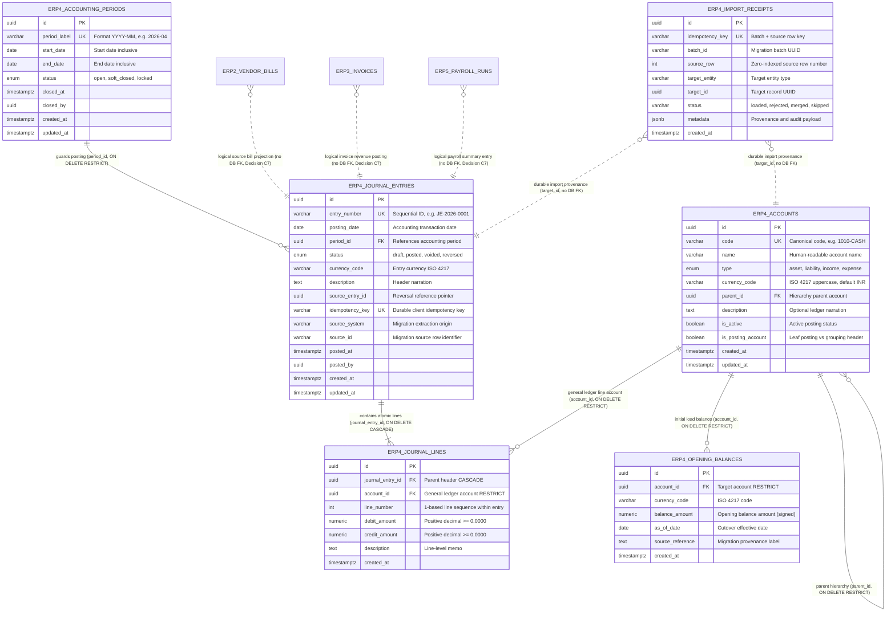

# ERP-4 Finance & Accounting: Entity-Relationship Diagram (ERD)

**Issue**: [ERP4-24 / #180](https://github.com/SamAltmanBT29/Clearshift-ERP/issues/180), Gate G1 Design Artifact  
**PostgreSQL Schema**: `erp4`  
**Reference Document**: SDS ClearShift ERP v2.0 §7.9  

---

## 1. Architecture & Ownership Boundaries

ERP-4 Finance & Accounting is the authoritative system of record for the General Ledger, Chart of Accounts, Double-Entry Journal Entries, Fiscal Periods, and Opening Balances.

- **Solid lines** indicate real physical PostgreSQL foreign key constraints within the `erp4` database schema.
- **Dotted lines** indicate cross-module logical projections and read-only references governed by Decision C7 (no cross-database foreign keys). Cross-module mutations must use owning APIs.

---

## 2. Mermaid Entity-Relationship Diagram

---

## 3. Primary Key, Foreign Key & Invariant Enforcement

| Table | Primary Key | Foreign Keys & Actions | Unique Constraints | Check Invariants |
|---|---|---|---|---|
| `erp4.accounts` | `id` (UUID) | `parent_id` → `erp4.accounts(id)` ON DELETE RESTRICT | `code` UNIQUE | `type IN ('asset','liability','income','expense')` |
| `erp4.accounting_periods` | `id` (UUID) | None | `period_label` UNIQUE | `start_date <= end_date`, `status IN ('open','soft_closed','locked')` |
| `erp4.journal_entries` | `id` (UUID) | `period_id` → `erp4.accounting_periods(id)` ON DELETE RESTRICT | `entry_number` UNIQUE, `idempotency_key` UNIQUE (partial) | `status IN ('draft','posted','voided','reversed')` |
| `erp4.journal_lines` | `id` (UUID) | `journal_entry_id` → `erp4.journal_entries(id)` ON DELETE CASCADE, `account_id` → `erp4.accounts(id)` ON DELETE RESTRICT | `(journal_entry_id, line_number)` UNIQUE | `debit_amount >= 0`, `credit_amount >= 0`, `NOT (debit_amount = 0 AND credit_amount = 0)`, `NOT (debit_amount > 0 AND credit_amount > 0)` |
| `erp4.opening_balances` | `id` (UUID) | `account_id` → `erp4.accounts(id)` ON DELETE RESTRICT | `(account_id, currency_code)` UNIQUE | None |
| `erp4.import_receipts` | `id` (UUID) | None (logical target_id) | `idempotency_key` UNIQUE | `status IN ('loaded','rejected','merged','skipped')` |
