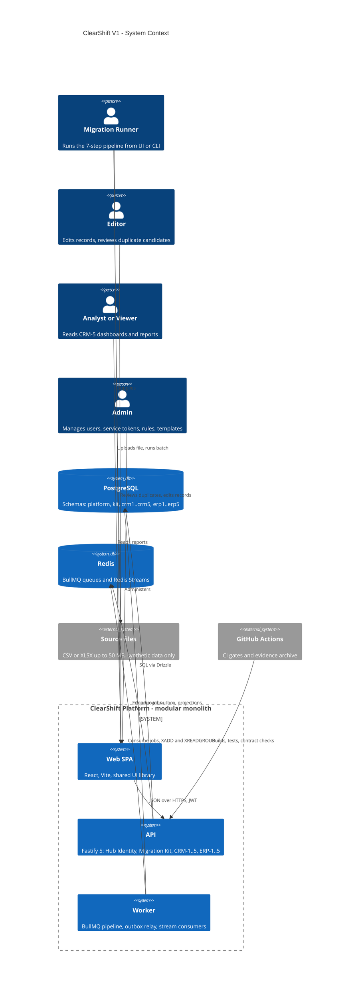
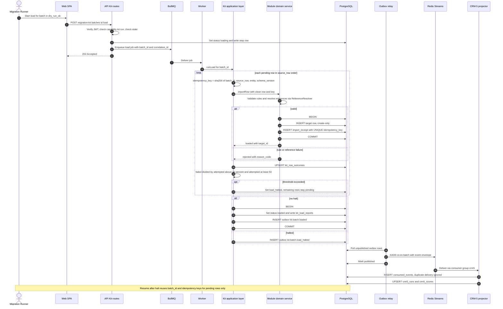

# ClearShift V1 — Unified Master Architecture Spec
**Baseline 1.0-A** · **Scope**: ClearShift Migration Kit + CRM (5 modules) + ERP (5 modules) · **Target**: Gate G4 (Week 8) · **Authority**: V1 Standardization Plan + SDS v1.0 ×3 (*SDS v2.0 does not exist; Std Plan wins on conflict*) · **Phase-1 decisions C1–M8 ratified**.

---

## 0. Decision Ledger (Ratified)

| ID | Decision | Impact & Enforcement |
|---|---|---|
| **C1** | **Source of Truth**: Std Plan + issues are authoritative. SDS v1.1 patch required. | 4-term equation, rollback moved to V2, exact-match only, mapping screen in V1 scope. |
| **C2** | **Runtime Topology**: Modular Monolith. | One Fastify 5 API deployable + one BullMQ worker deployable. Hub = internal `@cs/identity` and platform modules. |
| **C3** | **Identity & Token Issuer**: In-system Hub Identity. | Issues and verifies EdDSA/JWKS JWTs, argon2id, service tokens. `erp5_users` is a read-only projection/view. |
| **C4** | **Kit → Target Write Path**: In-process adapter. | Directly invokes module domain service; target row + import receipt commit in one atomic PostgreSQL transaction. |
| **C5** | **Raw/Staging Storage**: JSONB in `kit.raw_rows`. | `UPDATE`/`DELETE` revoked on raw tables; typed target tables `kit.clean_<module>`. Zero runtime dynamic SQL identifiers. |
| **C6** | **Golden ID in V1**: Minted at CRM-1 load by exact keys. | Resolves via `idmap/resolve?email=`. Unresolved customer rejected with code `CUSTOMER_UNRESOLVED`. |
| **C7** | **Cross-Module Integrity**: No cross-schema foreign keys. | References validated via `ReferenceResolver` port against owning module's public read facade. |
| **C8** | **Outcome & Equation Semantics**: 4-term equation. | `source = loaded + rejected + merged + skipped` (unaccounted = 0). Load is create-only. |
| **C9** | **Stop Threshold & States**: Per-row evaluation. | Halt when `failed / attempted > 10%` (minimum 50 attempted). Added states: `load_halted`, `resumed`. Dry run is mandatory. |
| **C10** | **PII Security Model**: Cryptographic column security. | Vendor bank AES-256-GCM column + masked projection. Salary visible to Admin + self only. Employee bank/gov-ID out of V1. |
| **H1–H13** | **Architecture & Schedule Realignment** | Kit-owned wizard screens; full OpenAPI authored at G1; per-key normalizers; non-destructive merge; per-module Dirty Data Packs; slots 11↔12 swap; domain Redis Streams; `deal.won` emit-only; no auto-posting in V1; frozen SDS table names; CRM-5 read-only re-scope; `consents` table authoritative. |
| **M1–M8** | **Engineering & Toolchain Standards** | Toolchain pins verified at PLT-01; half-up decimals; Tailwind + tokens; capacity ceilings; INT-* owned by Integration Lead; issues regenerated; Vitest/inject/k6 (no Newman); 4 shared DB roles + boundary lint. |

---

## 1. Repo Topology

- **Model**: Single monorepo `clearshift` (`pnpm` workspaces + Turborepo). Replaces Plan's polyrepo. Ownership enforced via `.github/CODEOWNERS`, not repository splits.

### Workspace Structure & Import Boundaries

| Workspace | Package | Role | Allowed Imports |
|---|---|---|---|
| `apps/api` | `@cs/api` | Fastify 5 composition root; registers ModuleDefinitions | All packages below |
| `apps/worker` | `@cs/worker` | BullMQ pipeline workers, outbox relay, stream consumers | `kit`, `platform`, `modules` (server entry only) |
| `apps/web` | `@cs/web` | React + Vite SPA shell, route table | `ui`, `contracts`, module web entries |
| `apps/cli` | `@cs/cli` (`cs-kit`) | CLI over the same Kit application layer | `kit`, `platform-identity` |
| `platform/kernel` | `@cs/kernel` | Config (Zod env), error envelope, logger, correlation, Result type, ports | None |
| `platform/db` | `@cs/db` | Drizzle schema registry, tx helper, role/grant SQL, migration runner | `kernel` |
| `platform/http` | `@cs/http` | Zod → OpenAPI type provider, pagination, error handler, safe-CSV | `kernel` |
| `platform/identity`| `@cs/identity` | Hub Identity: login/refresh, JWKS, verify plugin, service accounts, Golden ID map | `kernel`, `db` |
| `platform/rbac` | `@cs/rbac` | Capability matrix, route policy hook, field/object guards | `kernel`, `identity` |
| `platform/outbox` | `@cs/outbox` | Transactional outbox writer, relay, consumer dedupe, DLQ | `kernel`, `db` |
| `platform/audit` | `@cs/audit` | Append-only audit writer, redaction | `kernel`, `db` |
| `platform/telemetry`| `@cs/telemetry` | Pino, prom-client, health/readiness, lag probes | `kernel` |
| `core` | `@cs/core` | `clearshift-core`: 12 RL-* rules, per-key normalizers, exact matcher, Money/decimal | `kernel` |
| `kit` | `@cs/kit` | Migration Kit domain/application/infra (pipeline, state machine, ledger, reports) | `core`, `platform/*` |
| `modules/<id>` | `@cs/mod-<id>` | Business modules (`crm1..crm5`, `erp1..erp5`); exports `./server` and `./web` | `core`, `platform/*`, `contracts`, other modules' public facade only |
| `ui` | `@cs/ui` | Tokens, primitives, shell, data components, Kit wizard components | None server-side |
| `contracts` | `@cs/contracts` | OpenAPI files, event JSON-schemas, Prism mocks, generated TS clients | None |
| `testkit` | `@cs/testkit` | Factories, Dirty Data Pack generators + manifests, DB reset guard | `core` |

### Toolchain Baseline
- **Runtime**: Node 24 LTS · TypeScript strict (`noUncheckedIndexedAccess`) · `pnpm` · Turborepo.
- **Backend**: Fastify 5 · Zod + `zod-to-openapi` · Drizzle ORM + `drizzle-kit` · PostgreSQL 18 · Redis OSS 8 (Streams + BullMQ) · `jose` (EdDSA) · `argon2` · `csv-parse` · `exceljs` · `pino` · `prom-client`.
- **Frontend**: React + Vite + React Router + TanStack Query + React Hook Form + Tailwind CSS (token-mapped).
- **Testing & Verification**: Vitest · React Testing Library · Playwright · k6 · Prism · ESLint flat + Prettier + `dependency-cruiser` · `gitleaks` · `pnpm audit` + OSV scan.
- **Boundary Enforcement (M8)**: `dependency-cruiser` fails CI if a module imports another module's non-public path, an unexposed table schema, or `apps/*`. SQL lint rejects `schema.table` cross-schema references.
- **CI/CD Pipeline**: `verify` → `contract` → `integration` → `e2e` → `security` → `perf`.

---

## 2. File Structure (Domain-Driven Clean Architecture)

```
clearshift/
├─ .github/{workflows/*.yml, CODEOWNERS, ISSUE_TEMPLATE/v1-issue.md}
├─ .tool-versions  pnpm-workspace.yaml  turbo.json  tsconfig.base.json  eslint.config.js  .dependency-cruiser.cjs
├─ docker/{compose.yml, compose.mock.yml, api.Dockerfile, worker.Dockerfile, web.Dockerfile, initdb/00-roles.sql}
├─ docs/{adr/*.md, gates/G1..G4/, runbooks/{recovery.md,stream-lag.md}, data-dictionary/<module>.md, transitions.md, scope-change-log.md}
├─ scripts/{db-reset.ts, seed.ts, gen-openapi.ts, gen-clients.ts, check-issue-index.ts, check-dep-graph.ts}
├─ apps/
│  ├─ api/src/{main.ts, compose-root.ts, plugins/{cors,helmet,rate-limit,multipart,swagger}.ts, module-registry.ts}
│  ├─ worker/src/{main.ts, queues/{pipeline.queue.ts,load.queue.ts}, relays/outbox-relay.ts, consumers/{crm5-projector.ts,hub-consumer.ts}}
│  ├─ web/src/{main.tsx, app/{router.tsx,providers.tsx,guards.tsx}, routes/*.tsx}
│  └─ cli/src/{index.ts, commands/{batch-create,run,report}.ts, auth.ts}
├─ platform/
│  ├─ kernel/src/{config/env.ts, errors/{app-error.ts,envelope.ts,codes.ts}, ports/{reference-resolver,clock,id-gen}.ts, result.ts, correlation.ts}
│  ├─ db/src/{registry.ts, tx.ts, roles.sql, migrate.ts, migrations/{platform,kit}/*.sql}
│  ├─ http/src/{zod-provider.ts, pagination.ts, error-handler.ts, safe-csv.ts, openapi.ts}
│  ├─ identity/src/{domain/{user,credential,key}.ts, application/{login,refresh,issue-service-token,resolve-golden-id,mint-golden-id}.ts, infrastructure/{schema.ts,jwks.ts,argon2.ts}, interface/{routes.ts,verify-plugin.ts}}
│  ├─ rbac/src/{capabilities.ts, matrix.v1.ts, policy-hook.ts, field-guard.ts, object-guard.ts}
│  ├─ outbox/src/{envelope.ts, write-event.ts, relay.ts, consumer.ts, dlq.ts, schema.ts}
│  ├─ audit/src/{append.ts, redact.ts, schema.ts}
│  └─ telemetry/src/{logger.ts, metrics.ts, health.ts, stream-lag.ts}
├─ core/src/{rules/{RL-TEXT-01..RL-TAX-01}.ts, normalizers/{email,phone,name,sku,tax,text}.ts, match/exact.ts, money/{money.ts,currency-exponent.ts}, index.ts}
├─ kit/src/
│  ├─ domain/{batch.ts, state-machine.ts, row-outcome.ts, reconciliation.ts, threshold.ts, idempotency.ts, errors.ts}
│  ├─ application/{create-batch, extract, profile, clean, map, exclude-rows, dry-run, load, resume, validate, reconcile, decide-duplicate}.ts
│  ├─ ports/{target-adapter.ts, module-kit-config.ts}
│  ├─ infrastructure/{schema.ts, repositories/*, parsers/{csv-stream,xlsx-stream}.ts, storage/local-upload.ts, queues.ts, migrations/*.sql}
│  └─ interface/{routes.ts, openapi.ts, events.ts}
├─ modules/<id>/                      # crm1..crm5, erp1..erp5 (symmetric clean architecture)
│  ├─ src/
│  │  ├─ domain/{entities, value-objects, services, policies/transitions.ts, events.ts, errors.ts}
│  │  ├─ application/{use-cases/*.ts, ports/*.ts, dto.ts}
│  │  ├─ infrastructure/{schema.ts, repositories/*, receipts.ts, outbox.ts, migrations/*.sql}
│  │  ├─ interface/{routes.ts, openapi.ts, authz.ts}
│  │  ├─ kit/{field-registry.ts, dup-policy.ts, target-adapter.ts, reject-labels.ts, mapping-defaults.ts}
│  │  ├─ public.ts                    # Only cross-module import surface (facade + ReferenceResolver)
│  │  └─ index.ts                     # export const module: ModuleDefinition
│  ├─ web/{routes.tsx, pages/*, components/*, api.ts, kit-metadata.ts}
│  ├─ test/{unit, api, e2e, fixtures/dirty-pack-100.csv, fixtures/manifest.json}
│  └─ docs/{data-dictionary.md, erd.md, test-matrix.md}
├─ ui/src/{tokens/{tokens.css,tailwind.preset.ts}, primitives/*, shell/*, data/*, forms/*, kit/*, a11y/*}
├─ contracts/{openapi/{platform,kit,crm1..erp5}.yaml, events/*.schema.json, mocks/prism.config.json, clients/*}
└─ testkit/src/{factories/*, dirty-pack/{shared-1000.ts,manifest.shared.json}, db-guard.ts}
```

---

## 3. Frontend Architecture

### 3.1 Routing & Capability Gates

| Route Path | Owner | Capability Guard | Description |
|---|---|---|---|
| `/login` | `platform` | Public | Hub login screen |
| `/` | `crm5` | `control.read` | Executive control dashboard |
| `/crm1/{contacts,contacts/:id,companies,leads}` | `crm1` | `crm1.read` | Contact and lead management |
| `/crm2/{deals,quotes}` | `crm2` | `crm2.read` | Opportunity pipelines |
| `/crm3/tickets[/:id]` | `crm3` | `crm3.read` | Service desk ticketing |
| `/crm4/{lists,campaigns,consents/:contactId}` | `crm4` | `crm4.read` | Marketing and consent registry |
| `/crm5/{runs,scores,reconciliation/:batchId}` | `crm5` | `control.read` | Audit and quality analytics |
| `/erp1/{products,stock}` | `erp1` | `erp1.read` | Catalog and stock levels |
| `/erp2/{vendors,purchase-orders}` | `erp2` | `erp2.read` | Procurement |
| `/erp3/{sales-orders,invoices,payments}` | `erp3` | `erp3.read` | Order-to-cash |
| `/erp4/{accounts,journal-entries,trial-balance}`| `erp4` | `erp4.read` | General ledger |
| `/erp5/{employees,departments,leave}` | `erp5` | `erp5.read` | HR & personnel |
| `/<module>/import` | `kit` | `kit.run` | Kit wizard pre-bound to module metadata |
| `/kit/batches`, `/kit/batches/new` | `kit` | `kit.read` / `kit.run`| Batch oversight and execution |
| `/kit/batches/:id/{profile..reconciliation}` | `kit` | `kit.read` / `kit.run`| 7-step pipeline workspace |
| `/kit/mappings` | `kit` | `kit.read` (`kit.admin` for edit) | Mapping template manager |

### 3.2 Design Tokens (`ui/tokens/tokens.css`)

| Token | Light Theme | Dark Theme | Purpose |
|---|---|---|---|
| `--cs-bg` | `#FFFFFF` | `#0B0F14` | Primary canvas background |
| `--cs-surface` | `#F5F6F8` | `#131A22` | Card and panel surface |
| `--cs-border` | `#D0D5DD` | `#2A3441` | Element borders |
| `--cs-text` | `#111827` | `#F3F4F6` | Primary body text |
| `--cs-text-muted` | `#4B5563` | `#A8B3C2` | Subtitles, helper text |
| `--cs-accent` | `#1D4ED8` | `#7AA2FF` | Interactive buttons, links |
| `--cs-ok` / `--cs-ok-bg` | `#166534` / `#DCFCE7` | `#86EFAC` / `#0F2A1A` | Success states |
| `--cs-warn` / `--cs-warn-bg`| `#92400E` / `#FEF3C7` | `#FCD34D` / `#2E2208` | Warnings, review items |
| `--cs-err` / `--cs-err-bg` | `#B91C1C` / `#FEE2E2` | `#FCA5A5` / `#341212` | Errors, halts, rejects |
| `--cs-focus` | `#1D4ED8` 2px outline | `#7AA2FF` 2px outline | Focus ring for WCAG AA |

- **Spacing**: 4px base (`--cs-s-1` = 4px ... `--cs-s-12` = 64px).
- **Breakpoints**: md 768px, lg 1024px (tablet landscape = minimum supported layout), xl 1280px.

---

## 4. Backend Architecture

### 4.1 Service Boundaries & Transaction Model
- **`apps/api`**: Exclusively handles HTTP request lifecycles, authentication, schema validation, and synchronous use cases.
- **`apps/worker`**: Exclusively processes asynchronous tasks (BullMQ pipeline, outbox relay, event stream consumption).
- **Transaction Guarantee**: Rows migrated into target tables and their corresponding `<module>_import_receipts` are committed in the same local PostgreSQL transaction via the in-process `TargetAdapter`.

### 4.2 RBAC Capability Matrix

| Capability | Viewer | Editor | Migration Runner | Analyst | Admin |
|---|:---:|:---:|:---:|:---:|:---:|
| `<module>.read` | ✔ | ✔ | — | CRM-5 + Finance Reports | ✔ |
| `<module>.write` | — | ✔ | Create-only via Kit/API | — | ✔ |
| `kit.read` | ✔ | ✔ | ✔ | ✔ | ✔ |
| `kit.run` | — | — | ✔ | — | — |
| `kit.review` | — | ✔ | — | — | ✔ |
| `kit.admin` | — | — | — | — | ✔ |
| `control.read` | ✔ | — | — | ✔ | ✔ |
| `hub.admin` | — | — | — | — | ✔ |

### 4.3 Migration Pipeline & 4-Term Accounting Equation
- **Batch States**: `created` → `extracted` → `profiled` → `cleaned` → `mapped` → `dry_run_ok` → `loading` → `loaded` → `validated` → `reconciled`.
- **Halt States**: `loading` → `load_halted` → `resumed` → `loading`.
- **Threshold Rule**: Evaluate per row: halt immediately if `failed / attempted > 0.10` and `attempted >= 50`.
- **Reconciliation Equation**:
  $$\text{source} = \text{loaded} + \text{rejected} + \text{merged} + \text{skipped}$$
  $$\text{unaccounted} = 0 \implies \mathbf{OK}$$
  *(A halted batch results in status **PARTIAL**; never OK).*

---

## 5. Mermaid System Diagrams

### 5a. C4 System Context Diagram



### 5b. Core Transaction Sequence Diagram



### 5c. Entity Relationship Diagram (ERD)

```mermaid
erDiagram
  HUB_USERS ||--o{ HUB_CREDENTIALS : has
  HUB_USERS ||--o{ HUB_REFRESH_TOKENS : holds
  HUB_USERS {
    uuid id PK
    text username UK
    text roles
    uuid employee_ref
  }
  HUB_ID_MAP {
    uuid id PK
    text golden_id
    text source_system
    text source_id
  }
  OUTBOX {
    uuid id PK
    uuid event_id UK
    text event_type
    jsonb payload
    timestamptz published_at
  }
  CONSUMED_EVENTS {
    text consumer PK
    uuid event_id PK
  }
  AUDIT {
    uuid id PK
    text actor
    text action
    text entity
    jsonb diff_redacted
  }
  KIT_BATCHES ||--o{ KIT_BATCH_STEPS : steps
  KIT_BATCHES ||--o{ RAW_ROWS : extracts
  KIT_BATCHES ||--o{ STG_ROWS : stages
  KIT_BATCHES ||--o{ KIT_ROW_OUTCOMES : accounts
  KIT_BATCHES ||--o{ KIT_REJECTS : rejects
  KIT_BATCHES ||--o{ KIT_MERGES : merges
  KIT_BATCHES ||--o| KIT_RECONCILIATIONS : reconciles
  KIT_MAPPINGS ||--o{ KIT_BATCHES : applied_to
  KIT_BATCHES {
    uuid id PK
    text module
    text status
    text checksum
    text date_format
    text phone_country
  }
  RAW_ROWS {
    uuid batch_id FK
    int source_row
    jsonb payload
    text row_hash
  }
  STG_ROWS {
    uuid batch_id FK
    int source_row
    text status
    text reject_reason
    text golden_id
  }
  KIT_ROW_OUTCOMES {
    uuid batch_id FK
    int source_row
    text outcome
    uuid target_id
    text reason_code
  }
  KIT_RECONCILIATIONS {
    uuid batch_id FK
    int source
    int loaded
    int rejected
    int merged
    int skipped
    int unaccounted
    text result
  }
  KIT_MAPPINGS {
    uuid id PK
    text module
    text name
    int version
  }
  CRM1_COMPANIES ||--o{ CRM1_CONTACTS : employs
  CRM1_CONTACTS ||--o{ CRM1_LEADS : links
  CRM1_COMPANIES {
    uuid id PK
    text name
    text tax_number
  }
  CRM1_CONTACTS {
    uuid id PK
    text email
    text phone
    uuid company_id FK
    text lead_status
    text golden_id
  }
  CRM2_STAGES ||--o{ CRM2_DEALS : in_stage
  CRM2_DEALS ||--o{ CRM2_QUOTES : quoted
  CRM2_DEALS {
    uuid id PK
    uuid contact_id
    numeric value
    uuid stage_id FK
  }
  CRM2_QUOTES {
    uuid id PK
    text quote_number UK
    numeric amount
  }
  CRM3_TICKETS ||--o{ CRM3_NOTES : has
  CRM3_TICKETS {
    uuid id PK
    text subject
    text status
    text priority
    uuid contact_id
    text order_ref
  }
  CRM4_LISTS ||--o{ CRM4_CAMPAIGNS : targets
  CRM4_CAMPAIGNS ||--o{ CRM4_MEMBERS : includes
  CRM4_MEMBERS {
    uuid id PK
    uuid contact_id
    text status
    boolean unsubscribed
  }
  CRM4_CONSENTS {
    uuid id PK
    uuid contact_id
    text status
    text source
  }
  CRM5_RUNS {
    uuid id PK
    uuid batch_id
    text status
    int records_rejected
  }
  CRM5_SCORES {
    uuid id PK
    uuid batch_id
    numeric reject_rate
  }
  ERP1_CATEGORIES ||--o{ ERP1_PRODUCTS : classifies
  ERP1_PRODUCTS ||--o{ ERP1_STOCK_LEVELS : stocked
  ERP1_WAREHOUSES ||--o{ ERP1_STOCK_LEVELS : holds
  ERP1_PRODUCTS {
    uuid id PK
    text sku UK
    text normalized_sku UK
    text unit_of_measure
    numeric price
  }
  ERP1_STOCK_LEVELS {
    uuid id PK
    numeric quantity
  }
  ERP2_VENDORS ||--o{ ERP2_PURCHASE_ORDERS : supplies
  ERP2_PURCHASE_ORDERS ||--o{ ERP2_PO_LINES : contains
  ERP2_VENDORS {
    uuid id PK
    text tax_number
    text bank_masked
    bytea bank_enc
  }
  ERP2_PO_LINES {
    uuid id PK
    uuid product_id
    numeric line_total
  }
  ERP3_SALES_ORDERS ||--o{ ERP3_SO_LINES : contains
  ERP3_SALES_ORDERS ||--o{ ERP3_INVOICES : billed_by
  ERP3_INVOICES ||--o{ ERP3_INVOICE_LINES : contains
  ERP3_INVOICES ||--o{ ERP3_PAYMENTS : paid_by
  ERP3_SALES_ORDERS {
    uuid id PK
    text customer_golden_id
    numeric total
  }
  ERP3_INVOICES {
    uuid id PK
    text invoice_number UK
    date due_date
    text status
  }
  ERP4_ACCOUNTS ||--o{ ERP4_JOURNAL_LINES : posted_to
  ERP4_PERIODS ||--o{ ERP4_JOURNAL_ENTRIES : governs
  ERP4_JOURNAL_ENTRIES ||--|{ ERP4_JOURNAL_LINES : balanced_lines
  ERP4_ACCOUNTS ||--o{ ERP4_OPENING_BALANCES : opens
  ERP4_JOURNAL_LINES {
    uuid id PK
    numeric debit
    numeric credit
  }
  ERP5_DEPARTMENTS ||--o{ ERP5_EMPLOYEES : staffs
  ERP5_EMPLOYEES ||--o{ ERP5_LEAVE : takes
  ERP5_EMPLOYEES {
    uuid id PK
    text employee_no UK
    date birth_date
    date join_date
    bytea salary_enc
  }
  CRM1_CONTACTS ||..o{ CRM2_DEALS : contact_id
  CRM1_CONTACTS ||..o{ CRM3_TICKETS : contact_id
  CRM1_CONTACTS ||..o{ CRM4_MEMBERS : contact_id
  CRM1_CONTACTS ||..o{ CRM4_CONSENTS : contact_id
  CRM1_CONTACTS ||..o{ HUB_ID_MAP : golden_id
  HUB_ID_MAP ||..o{ ERP3_SALES_ORDERS : customer_golden_id
  ERP1_PRODUCTS ||..o{ ERP2_PO_LINES : product_id
  ERP1_PRODUCTS ||..o{ ERP3_SO_LINES : product_id
  ERP3_INVOICES ||..o{ ERP4_JOURNAL_LINES : accounting_reference
  KIT_BATCHES ||..o{ CRM5_RUNS : batch_id
```



---

## 6. Issue Resolution & Standardization Matrix

### 6.1 Business-Module Template (Slots 01 to 30)

| Slot | Role | Architecture Target Path | Sprint | Ratified Resolution Applied |
|---|---|---|---|---|
| **01** | R1 | `src/infrastructure/{schema.ts,migrations/}` | S1 | SDS table names frozen (H11); intra-module FKs only (C7); receipts table `<id>_import_receipts`. |
| **02** | R1 | `src/infrastructure/repositories/`, `testkit/` | S1 | Parameterized Drizzle queries; deterministic factories. |
| **03** | R1 | `src/interface/routes.ts` | S2 | Standard pagination (25 default, 1..100), sort allowlists, id tie-breaker. |
| **04** | R1 | `src/interface/`, `src/public.ts` | S2 | Linked data retrieved through owning module's public facade only. |
| **05** | R1 | `src/application/use-cases/` | S3 | Zod validation, 409/422 status codes; CRM-5 re-scoped to idempotent projection upsert (H12). |
| **06** | R1 | `src/domain/policies/transitions.ts` | S3 | State matrices enforced; CRM-5 re-scoped to run-state derivation (H12). |
| **07** | R1 | `ReferenceResolver` impl in `public.ts` | S4 | Zero cross-schema FKs; existence checked in-process. |
| **08** | R1 | `src/infrastructure/outbox.ts` | S4 | Standard transactional outbox envelope. |
| **09** | R2 | `src/index.ts` (`ModuleDefinition`) | S1 | Registers into `apps/api/module-registry.ts`; single Compose stack. |
| **10** | R2 | `src/kit/field-registry.ts`; `kit.clean_<id>` | S1 | JSONB raw storage (C5); zero dynamic SQL identifiers. |
| **11** | R2 | `src/kit/target-adapter.ts`, `receipts.ts` | S3 *(swap)* | In-process, same-tx target row + receipt (C4); depends on KIT-08. |
| **12** | R2 | `src/kit/dup-policy.ts` + `@cs/core` | S2 *(swap)* | Depends on KIT-03 key-declaration; per-key normalizers (H4). |
| **13** | R2 | Adapter error classification | S4 | Per-row threshold evaluation; `load_halted` / `resumed` states (C9). |
| **14** | R2 | `contracts/openapi/<id>.yaml`, mocks | S1 | Full authoritative route set derived at G1 (H1). |
| **15** | R2 | `src/interface/authz.ts` | S2 | Capability matrix enforcement; object-level guards. |
| **16** | R3 | `web/routes.tsx` | S1 | Route table registration. |
| **17** | R3 | `web/pages/`, `@cs/ui` `DataTable` | S2 | Server-side pagination only. |
| **18** | R3 | `web/components/` | S2 | URL search params as list state source of truth. |
| **19** | R3 | `StateBoundary` | S1 | Shared loading, error, empty, and forbidden states. |
| **20** | R3 | `web/pages/` | S3 | RHF + Zod; CRM-5 re-scoped to filter/export form (H12). |
| **21** | R3 | `web/pages/` | S3 | CRM-5 re-scoped to drill-down detail (H12). |
| **22** | R3 | `web/kit-metadata.ts` | S4 | Module supplies metadata to shared Kit wizard (no duplicated wizards) (H2). |
| **23** | R3 | `src/kit/reject-labels.ts` | S4 | Masked and allowlisted columns, safe CSV export. |
| **24** | R4 | `docs/{data-dictionary,erd}.md` | S1 | Freezes transition matrix and table names at G1. |
| **25** | R4 | `test/fixtures/`, `testkit/dirty-pack` | S2 | Disjoint defect sets with manifest (H6). |
| **26** | R4 | Module profile configuration | S2 | Manifest-count assertions. |
| **27** | R4 | Rule toggles + test fixtures | S3 | 12 RL-* rules only. |
| **28** | R4 | `src/kit/mapping-defaults.ts` | S3 | Versioned mapping templates. |
| **29** | R4 | `test/{unit,api,e2e}` | S4 | Vitest + inject + Playwright; ≥60% core coverage. |
| **30** | R4 | `docs/gates/G4/<id>/` | S4 | 4-term reconciliation proof (`unaccounted = 0`). |

*Per-Sprint Load per Module*: **S1**: 8 slots · **S2**: 8 slots · **S3**: 7 slots · **S4**: 7 slots.

---

## 7. Open Verification & Execution Items

1. **PLT-01 Toolchain Verification**: Confirm official container digests and patch releases for PostgreSQL 18, Redis OSS 8, and Node 24 LTS; record in `.tool-versions`.
2. **Dependency Graph Validation**: Run `check-dep-graph.ts` (or Python equivalent in `scripts/`) to reflect the slot 11 ↔ 12 swap.
3. **Regenerate Issue Catalog**: Update and align the 360-issue bodies from this finalized schema before GitHub sync.
